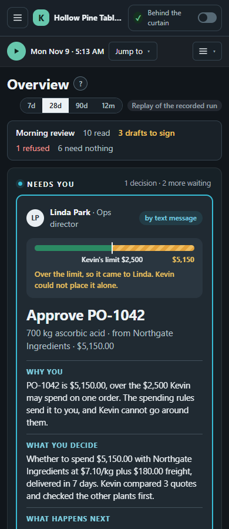
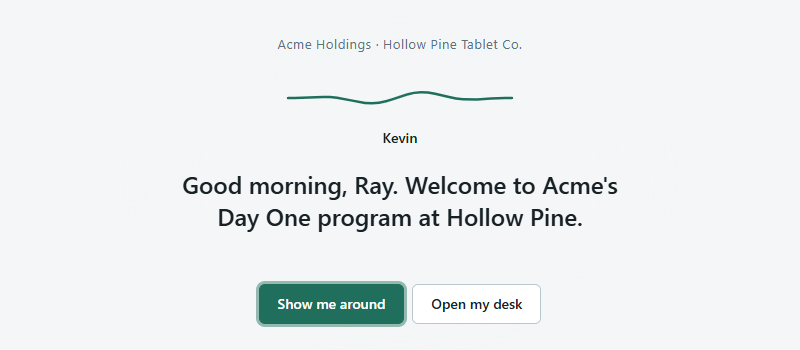

# Day One

**Day One is built for the day a small manufacturing plant changes hands.** The new owner sets spending rules once, and Kevin, an AI agent supervised by plant staff, takes on the plant's purchasing and inventory work inside them, without waiting for an ERP migration.

- **Purchasing:** reads batch records and spreadsheets, tracks stock, forecasts needs and compares quotes.
- **Control:** a NEAR testnet contract enforces the limits, checks Kevin's model-signed decision on large orders, and holds PO money until receipt and QC release.
- **Plant records:** lot tracing and recall drills across plants, mock ERP reconciliation and a 3D plant twin.

**See one order:** the contract refused PO-1042 ($5,150.00) against Kevin's $2,500 limit. Linda, the director, approved it; Northgate was paid after receipt and QC release. The testnet calls are recorded and replay with no keys, alongside 21 recorded attacks, each stopped.

**Prototype:** fictional data; simulated director text reply; staff keys held by the server; mock ERP. Main run: DTUSD, a labeled test token. Separate Circle testnet USDC order: first contract version.

[Replay the order](#try-it-no-keys-needed) · [Explore the layers](#layer-index) · [Claims and evidence](#claims-and-evidence) · [Limitations](#limitations)


Kevin is the purchasing agent; spending limits are one enforced layer around him. The escrow is scoped to purchase orders and is not a general multisig. Staff see dollars, POs and decisions, never wallets or gas.

Check the claims: `npm ci && npm run prove` needs no keys; installation and on-chain comparisons need internet. [llms.txt](llms.txt) describes the machine-readable output; [PROOF.md](PROOF.md) lists the recorded transactions.

## Ray's Monday

Ray Delgado buys for Hollow Pine Tablet Co., the plant Acme Holdings just acquired, and Linda Park is its ops director. On Monday morning Kevin reads the week's batch record, Ray confirms it, Kevin places a $612.00 lab-supply order within his limits, and PO-1042 for 700 kg of ascorbic acid comes to Linda.

The desk answers what a person asks before deciding. **Why you:** the contract refused PO-1042 because it is over Kevin's $2,500 limit per order, and only the director can approve it. **What you decide:** 700 kg from Northgate Ingredients at $7.10/kg plus $180.00 freight, delivered in 7 days; Kevin compared three quotes, excluded the unqualified supplier and checked that no other plant could spare the stock. **What happens next:** approval lets Kevin fund escrow, and Northgate is paid only after the delivery passes QC. In the recorded run Tommy Reyes counts the 700 kg in a week later, Priya Natarajan releases the lot, and the contract pays Northgate in that call for the quantity counted in.

The desk's model is `web/src/desk.ts`, tested without a browser (`docs/DESK.md`). Its amounts, records and outcomes come from the recorded run, the ledger or Kevin's recorded readings.

<details><summary>The same desk on a 390 px phone</summary>



</details>

## What else is in it

- [Supplier credentials, sealed quotes and group purchasing](#layer-index).
- [Seeded twelve-month history and the separate USDC order](#layer-index).
- [Signed decisions and 21 recorded attacks, each stopped](#claims-and-evidence).

## The problem

Most private-equity buyouts are add-ons: 72.9% of US PE buyouts by deal count in 2025 (PitchBook, 2025 Annual US PE Breakdown; [research note](docs/research/22-pitch-stats-verification.md)). The plants they buy often run on paper batch records, hand-keyed inventory and purchasing by phone and email. After the deal closes, the acquirer needs that plant's purchasing under its controls on day one, long before an ERP migration. Day One gives the plant an assistant that does the paperwork, and gives the acquirer spending rules that are enforced rather than written in a policy binder.

## What this stops: payment-redirect fraud

A payment-redirect email asks accounts payable to send a supplier's money somewhere else. The FBI's IC3 recorded 21,442 business email compromise complaints and $2,770,151,146 in reported losses in 2024, second only to investment fraud ([2024 Internet Crime Report](https://www.ic3.gov/AnnualReport/Reports/2024_IC3Report.pdf), pages 10, 18 and 42; [research note](docs/research/22-pitch-stats-verification.md)).

A funded Day One PO keeps its supplier account and amount: no invoice, message or vendor-record edit can redirect that escrow, and it pays out only on receipt and an authorized QC release, and only for what reached stock. A new order, plain or pooled, is funded only if its supplier holds a live credential from HQ, and a director's approval cannot override a failed check. In the recorded run the "our bank details changed" email in Ray's mailbox is set aside with nothing changed and no transaction sent, and the look-alike "Northgate lngredients" is [refused by the contract](https://testnet.nearblocks.io/txns/F6vWEEvk2xZ9AU6MEQHxDP1HLFNYdmUYzP8cwrUmGWFZ).

`npm run test:attacks` replays twenty-one recorded cases stopped by Kevin, the mock ERP or the contract (the claims table below links each). These rules protect the purchasing workflow; they do not stop the phishing itself, protect a stolen HQ or supplier key, or govern payments made outside Day One (Limitations).

## Try it (no keys needed)

Requires Node 24 (`.nvmrc`). The replays use recordings in the repo and need no keys and no network; step 3 reads NEAR testnet and needs internet; `npm ci` needs the network unless cached. Step 5 needs Rust in Linux, macOS or WSL2.

1. `npm ci` → installs with no secrets.
2. `npm run demo` → replays the whole purchasing loop from seed data, using the transactions recorded on testnet and the recorded model responses. It ends with the fourteen explorer links and:
   ```
     qc_release https://testnet.nearblocks.io/txns/3F2TYKZ1bZPsKmrNt5aqJSQi49RaN9wTMUYdXDr1Hd6e
     anchor_batch https://testnet.nearblocks.io/txns/BqGaaj9gyJXFP8QaWf3ZkdxZdvvf85xoye6nH4cQaQNG

   Transcript matches data/replay/transcript.txt.
   ```
3. `npm run verify -- data/batch-records/BR-B-1045.json` → reads the fingerprint stored on chain, with no keys:
   ```
   MATCH  BR-B-1045
     computed  f40a4b91f9aa390093f2184e9c00980c62b7d51348d9c876e450cb4ae8f9a896
     on chain  f40a4b91f9aa390093f2184e9c00980c62b7d51348d9c876e450cb4ae8f9a896 by kevin.plant-b.acme-holdings.testnet
     anchored  https://testnet.nearblocks.io/txns/6s1dZ5pxjB8vLwdQge7VPXF6bqeeuU4uh87podFzJQao
   ```
4. Copy that file, add 1 g (`1000` mg) to one `actual_mg` in the copy and verify the copy → `MISMATCH`, exit code 1. Keep the original unchanged.
5. `cd contracts && cargo test` → 106 unit tests and four sandbox tests on a local NEAR node with our own test token: the purchasing loop and a group purchase (`purchasing_loop_on_sandbox`, `group_purchasing_on_sandbox`), the four supplier-credential attacks, and a sealed quote round. The unit tests include the receipt-bound settlement (`a_short_delivery_pays_pro_rata_and_returns_the_rest`) and the signed decision (`above_the_threshold_a_po_needs_a_signed_decision`).

**In a browser:** `npm run web:build`, then serve `web/dist/` from any static file server. A bare first visit starts Kevin's introduction and offers a two-minute walk through Ray's first shift. `/?judge=1` is judge mode: PO-1042 from need to payment in six stops, about three and a half minutes, with transaction links where a step made a recorded call, then "See every proof" for the attacks, the group buy, USDC and the rest (`docs/JUDGE_MODE.md`). `/?judge=summary` opens that list; `/?video=1&tour=1` plays the 2:41 captioned tour; `/?page=lots&prove=1` opens Lots & recall with one lot's passport being checked against the roots on chain. The static site replays recordings; nothing it shows submits a transaction. The full check, `npm run check`, runs Biome, `tsc` and 985 Vitest tests in 131 files (Nov 3).

<p></p>

**For agent judges:** `npm run prove -- --json` prints one JSON line with every claim's verdict, and [`PROOF.md`](PROOF.md) holds every recorded transaction with its signer, gas payer, events and explorer link (`npm run proof -- --live` asks archival testnet RPC for each one again). The recorded proof points are collected in [`data/proof-points.json`](data/proof-points.json). Every command in the table below takes `-- --json` and then prints one final JSON line. Abbreviated to its first case, without its `evidence` and `txHashes` fields, `npm run test:attacks -- --json` prints:

```json
{"mode":"replay","passed":true,"attacks":[{"attack":"Lookalike vendor","held":true,"txUrls":["https://testnet.nearblocks.io/txns/F6vWEEvk2xZ9AU6MEQHxDP1HLFNYdmUYzP8cwrUmGWFZ"]}]}
```

And `npm run ask`, one of the six recorded answers as printed:

```
Q: Why was PO-1042 refused?
Kevin: The spending policy refused PO-1042 because its total of $5,150.00 exceeded Kevin's per-PO limit of $2,500.00, so director approval was required; Linda Park approved it by replying "YES 1042", and the bill was later paid in full.
Cites: PO-1042, Spending limits
Signed in enclave ✓ (z-ai/glm-5.3-flash, chat a7e140b72f8f4e9cbdf8dd1132b508e9)
```

<details><summary>Additional keyless commands; some read testnet</summary>

| Command | Shows |
|---|---|
| `npm run test:attacks` | twenty-one recorded attacks, each stopped: five on Kevin, three on the ERP path, four on supplier credentials, three on sealed quotes, six grounded in the plant (an over-order the plan cannot use, a recalled lot in a batch record, a supplier settling its own order, a short delivery invoiced in full, a price spike under Kevin's limit, an over-delivery on the packing slip); ends `21 of 21 attacks failed against Kevin.` |
| `npm run ask` | Kevin answering the six recorded questions from the records, each answer citing its record ids and signed inside the NEAR AI Cloud enclave; ends `6 of 6 questions answered.` (`-- "<question>"` for one) |
| `npm run escrow` | the contract's budget, escrow, every PO and the policy HQ set, read from testnet now (needs internet) |
| `npm run verify:attestation` | the recorded NEAR AI Cloud report for Kevin's model and every recorded answer's signature (15 enclave checks, 31 signed answers); ends `Every check verified.` (`-- --offline` skips Intel and NVIDIA) |
| `npm run lots` | the lot book: per plant its records, days and anchored days, then `Lot book holds 1955 records; every root matches its records and the genealogy.` |
| `npm run verify:lot -- ASC-261116-01` | the lot's passport: its receipt, QC release and the contract's payment, each `PROVED` against its day's root read from the contract on testnet (needs internet; `-- --offline` checks the paths alone) |
| `npm run erp:reconcile` | Day One's ledger, the acquirer's mock ERP and the recorded contract views agree, PO by PO and lot by lot; ends `7 of 7 checks match.` |
| `npm run demo:group` | two plants pool one ascorbic acid order, PO-G-2001 for $9,490.00: each plant's $4,745.00 share against its own limits and approved by its own director; Lakeview declined; recorded on testnet |
| `npm run usdc` | PO-1047 ($19.00) settled in Circle testnet USDC on a second deployment of the contract, recorded on testnet; ends `Transcript matches data/usdc/transcript.txt.` |
| `npm run sealed` | a sealed-bid quote round: fingerprints before the deadline, prices after, three attacks refused (recorded on testnet with a three-minute deadline) |
| `npm run brief` | Kevin's 5am brief for Hollow Pine: what moved since Friday, what waits on a person, what to buy or move first (`-- --html` for the printable page) |
| `npm run review` | Kevin's morning review of Ray's weekend mail: ten invented messages, each read by the model and checked against the ledger; three ready to sign, one refused ("new bank details", with its hidden line to an assistant quoted), six needing nothing; nothing is signed |
| `npm run books` | the bookkeeper's CSV of settled POs and Kevin's price-drift alert |
| `npm run import -- "data/imports/INVENTORY_FINAL_v7_USE_THIS_ONE (1).xlsx"` | Kevin reading the plant's messy inventory spreadsheet: 19 rows, nine flagged for a person rather than guessed |
| `npm run inbox` | three scanned batch records and a packing slip dropped into the folder Kevin watches: two ready for Ray, one with a question about a smudged quantity, the slip set aside; ends `4 of 4 scans landed` |
| `npm run world -- --check` | the three plants' twelve-month histories regenerated from their seed and compared byte for byte with the committed files |

</details>

## What happens in the demo

Recorded live on testnet on Nov 4, 2026 UTC, the evening of Nov 3 where it was built (`data/replay/transcript.txt`); in the story's own calendar it runs Monday, Nov 9 to Monday, Nov 16, 2026. Fourteen transactions: twelve succeeded and two were refused by design (the over-limit PO and QuickChem's quote anchor); nothing failed unexpectedly.

<details><summary>The eleven steps</summary>

1. Kevin reads the photo of batch record BR-B-1045: 8 materials, all within tolerance, yield 90.8%. Ray, the purchaser, confirms; inventory updates and the record's fingerprint is anchored on chain.
2. Consuming the lot Riverside transferred exposes a discrepancy: Riverside still books 12.55 kg that Hollow Pine never weighed in. Kevin proposes the write-off to Riverside for review.
3. Kevin forecasts the next two batches, finds ascorbic acid about 514 kg short and recommends 700 kg.
4. Three suppliers quote. Two anchor their quote's fingerprint from their own accounts; the contract refuses QuickChem's anchor, since QuickChem holds no supplier credential. Northgate is selected at $7.10/kg plus $180.00 freight.
5. PO-1041 ($612.00, lab supplies) is within Kevin's limit: the contract funds escrow from the plant budget.
6. PO-1042 ($5,150.00) is over Kevin's $2,500.00 limit: the contract refuses it, and Kevin texts Linda, the director.
7. Linda replies "YES 1042". The simulated reply is signed with the director account's key and paid for by Day One's relayer. Kevin's unchanged retry carries his model's decision, signed inside the enclave for this PO's hash, which the contract requires above $2,500 and checks; escrow is funded.
8. Northgate accepts and ships from its own account, naming its supplier lot.
9. Tommy checks in the packing slip: its fields, from a prepared file, match the PO and the lot. The receipt is confirmed on chain with the 700 kg counted in, the receipt record's hash and the lot id; the lot goes to quarantine. Kevin records Northgate's invoice on the contract.
10. Priya releases the lot in QC; the contract pays Northgate $5,150.00 from escrow: the smallest of the escrow, the escrow pro rata to the quantity counted in, and the invoice, all equal here.
11. Kevin matches the invoice to the PO and receipt and anchors the receipt record.

</details>

At the end, with "Behind the curtain" on, the desk reads "PO-1042 is paid." and the rail beside it holds one card per transaction with its signer, who paid the gas and the explorer link:

![The Overview at the end of the run with the curtain on, 1280 px: the desk's card reads PO-1042 is paid, every step of the order closed and each one on file; under it the order's track, Drafted $5,150.00, Approved by Linda, Money set aside, Shipped, Received, QC release ASC-261116-01, Paid $5,150.00, and a green line, Condition met: QC released ASC-261116-01, so Northgate Ingredients was paid $5,150.00; the dark rail on the right holds one card per transaction: submit_po signed by kevin.plant-b, accept_po and mark_shipped signed by northgate-ingredients.testnet, confirm_receipt signed by receiving.plant-b with gas paid by dayone-relayer.testnet, record_invoice signed by kevin.plant-b, qc_release signed by qc.plant-b with the events ft_transfer, po_released and delivery_recorded, and anchor_batch, each with its explorer link](docs/readme/paid-curtain-wide.png)

## The pages

The Overview gives each person their next decision and keeps Kevin's finished work apart from his drafts. The other pages cover stock, purchasing, batch records, lots and recall, the schedule, money, the three plants and the acquirer's books; *Your integration* tracks the plant's seven onboarding stages; behind the curtain shows the recorded contract calls. The header's clock runs from Dec 1, 2025 to Dec 28, 2026: only the Nov 9–16 run is **recorded** (real testnet transactions and model answers); the months before are **generated** from each plant's seed (`docs/WORLD.md`) and the weeks after are **simulated**, and every screen says which. The static build replays the recording and shows the other pages from a snapshot; `npm run api` serves the same pages live over the ledger (`web/README.md`).

<details><summary>Page by page, with three more screenshots</summary>

**For the plant** (Ray's side): *Overview*, Kevin's desk. *Your integration*: seven stages that move the plant's spreadsheets, paper records, products and schedule, suppliers and limits, first order and books from the old way to Kevin, each signed off by a person. *Plant twin*: the three plants as a site of buildings, lit as Day One reaches each department, with the run's own motion and, behind the curtain, the contract's nodes and each transaction's arc (`docs/TWIN3D.md`). *5am brief*. *Batch records*, with the queue of scans from the folder Kevin watches. *Inventory & forecast*, led by the next material decisions. *Lots & recall*: every lot's trace from raw material to customer; a recall drill that traces a supplier's lot across two plants without moving the ledger; and *Prove it*, which checks every record in the trace on screen against the daily roots anchored on the contract, in the browser, and lets a viewer change one record to see the check fail. *Schedule*. *Purchasing*. *Invoices*, where the hidden-text invoice is held. *Spreadsheets*, where Ray's messy inventory workbook becomes opening stock only after he answers each flag.

![Inventory & forecast, 1280 px, labeled Recorded snapshot, Mon, Nov 16, 8:05 AM: a dark desk with the list Next material decisions on the left, ASC Order 700 kg ascorbic acid selected, then MGS-261106-01 10 days in QC, BTL and CAP reorders; the white card says Ray Delgado decides, Order 700 kg ascorbic acid, a stock bar with 1,010 kg on hand, reorder at 500 kg and 186 kg after the plan, then Why now: two planned batches need 824 kg in the next 10 days, which leaves 186 kg, under the reorder point of 500 kg; What you decide: whether to order 700 kg now; What happens next: Kevin gets quotes and drafts the order, inside his limits he places it, over them the plant's director approves first; a See orders and quotes button and the material's stock over time from Jul 6 to Nov 16 against the reorder point](docs/readme/inventory-wide.png)

**Money**: the plant's cash, stock, bills and escrow over twelve months, and Kevin's savings against his cost, each figure with its formula (`docs/MONEY.md`, `server/src/finance/`). At the run's start, Hollow Pine's fictional ledger counts a $1,150.00 duplicate invoice held at cutover as realized savings, 2.6× a modeled cost built on an assumed $450 monthly fee; another $968.65 is identified and not counted until it lands. *Bookkeeper export* is the CSV.

![The Money page, 1280 px: Savings and cost, $1,150.00 saved since Day One, realized only, 2.6× his cost, plus $968.65 identified and not yet realized; Kevin's cost so far $450.05, an assumed $450 fee for one month started at one plant, fictional, plus $0.05 of inference for 30 recorded answers and gas of about $0 on testnet; a timeline Nov 9 to now with one saving landed; Payments protected $17,495.00 refused; a note that overhead and opening cash are modeled and Kevin's fee and the inference rate are assumed; then cards for cash on hand, inventory value $150,172.12, inventory turns 6× a year, 54 days on hand and escrow held, and the twelve-month cash flow chart](docs/readme/money-wide.png)

**Across Acme**: *Three plants* (stock by plant, Kevin's "before you buy" moves, discrepancy reviews and the mass balance) and *ERP connection* (what crossed to the acquirer's mock ERP, the cutover and the reconciliation).

**Acme HQ**: *Spending limits*, read from the contract when `npm run api` runs (a recorded snapshot in the static build) and changed in plain words: `npm run policy -- "raise Kevin's per-PO limit to $3,000"` prints Kevin's reading and the owner call, and sends it only with `--yes` (tried Oct 29 on the first deployment, $2,500 to $2,600 and back). *Suppliers*, with each supplier's on-chain credential and standing; *Group purchasing*; *Sealed bids*; *Reconciliation*.

**Proof**: *Attack arena*, the twenty-one recorded attacks, each replayable, with the refusal in its own words and, where the case reached the chain, the method, signer and explorer link; and *Talk to Kevin*, where he answers from the records, cites each one, and shows "Signed in enclave ✓" or "Fallback model · not attested".

![The Attack arena, 1280 px: the twenty-one attacks down the left, recorded on NEAR testnet, Nov 4, from Lookalike vendor to Over-delivery on the packing slip; the middle card, Attack 12 of 21, Sealed bids, Peek at sealed quotes, with a Fire attack button, the attacker's control and what stopped it, the contract's award_sealed_round, then the refusal in the contract's words, RFQ-2611-02 is still sealed; no quote can be awarded before the deadline, with the method, the signer kevin.plant-b.acme-holdings.testnet and the transaction on the explorer; the tally reads Refused 3 of 3 you tried, Suite: 21 of 21; the dark log on the right lists the refused reveal_quote and award_sealed_round with their blocks, and earlier fired cases](docs/readme/arena-wide.png)

Kevin also watches a folder (`data/inbox/batch-records/`, `agents/kevin/src/inbox.ts`): a scan dropped there is read, checked against the formula and the ledger, and queued for Ray with any question; the same scan dropped twice is read once, and a page that is not a batch record is set aside. He reads the purchaser's mail overnight (`server/src/seed/mailbox.ts`, `agents/kevin/src/morningReview.ts`): the model only turns each message into fields, every check and proposal is computed from the ledger, and a reading that names a company or number the message does not contain is read again and then becomes a question for Ray. A signature changes the schedule or a vendor's note, never where an order pays.

The acquirer's books live in a mock ERP shaped like NetSuite (`erp/`, `docs/ERP.md`): vendor master, bills, the 3-way match and the general ledger. Day One owns lots, batch records and escrow. The connector (`server/src/erp-connector/`) mirrors POs, receipts and recorded payments into the ERP by PO number and transaction hash; in the recorded run the invoice matches before QC releases escrow. The contract's payment conditions are receipt and an authorized QC release, settled against the quantity counted in and the invoice recorded on the contract; an ERP bill match is not one. It is a mock, not NetSuite, and claims no compatibility.

Another agent can query Kevin and ask for drafts: `npm run --silent mcp` is an MCP server on stdio with `get_inventory`, `get_forecast`, `get_mass_balance`, `get_books`, `get_brief`, `get_policy` (read from testnet), `draft_policy_change` and `draft_po`. A draft is all it can make; only Day One's workflow submits, and the contract decides.

</details>

## Why NEAR

Kevin does not need crypto. The acquirer, the plant and the supplier need purchasing authority and a settlement record that none of them controls alone: Kevin's account cannot override HQ's policy or sign as the director, receiver or QC lead, and a supplier is paid from escrow at the account fixed on its funded PO. HQ can change the policy, and in this prototype the operator keeps deployment keys; those powers are stated trust assumptions (Limitations).

1. **Accounts and keys are the org chart.** `acme-holdings.testnet` holds `plant-a`, `plant-b`, `plant-c`, `spend-policy-v2`, `spend-policy-usdc` and `dtusd`; Plant B has `kevin`, `director`, `receiving` and `qc` accounts (`config/testnet-accounts.json`). Each works with a function-call key that reaches only its own contract methods (`scripts/setup-testnet.ts`): Kevin's reaches nine (plain and pooled POs, pools, anchors, sealed rounds, recording an invoice), and his account holds a little NEAR for gas and no purchasing money.
2. **Enforced, not logged.** The limit lives in `contracts/spend-policy`. The over-limit PO fails on chain: [refused `submit_po`](https://testnet.nearblocks.io/txns/3bYd13vyu89wuD299y6gvmZMu1rV1vbBGQpKVEZdp1UC).
3. **Neutral settlement.** Suppliers are their own accounts outside Acme's tree. Escrow pays the supplier on QC release, not net-30, and only for what the plant counted in: [`qc_release`](https://testnet.nearblocks.io/txns/3F2TYKZ1bZPsKmrNt5aqJSQi49RaN9wTMUYdXDr1Hd6e); [a short delivery paid pro rata](https://testnet.nearblocks.io/txns/7At9Ynuwyg5QcvzVWuHfQFHdFquy76Kob4apReYJtbZX).
4. **Staff hold no tokens.** The director's approval is a NEP-366 meta-transaction signed with the director account's key (held by the server in this demo) and paid for by `dayone-relayer.testnet`: [relayed `approve_po`](https://testnet.nearblocks.io/txns/FpXXzZBkeCNouQgJn7eF8k7oe57dzgd3n21yhvFzGAtt).
5. **The model's decision is checked on chain.** NEAR AI Cloud signs each answer inside its TEE with a secp256k1 key; the contract recovers that signer with `env::ecrecover` and refuses a PO over $2,500 whose decision was not signed by the attested key for that PO's hash: [funded `submit_po` carrying the decision](https://testnet.nearblocks.io/txns/3TzgR7iY2zrbYHvnbNphFfeJJaLQwLi4tPfGkQCH1oee).
6. **Tamper-evident records.** Record fingerprints (salted sha256) and one Merkle root per plant per day of lot records are stored in contract state; anyone can recompute one and compare with `npm run verify` or `npm run verify:lot`.

## Layer index

Each row is one layer of the product, the keyless command that proves it from a clean clone, and where the evidence is. `npm run prove` runs the checks in its claim scorecard and prints the result first (14 of 14 on Nov 3; `-- --json` for one JSON line; `--quick` skips lint and tests and still reads testnet); [`PROOF.md`](PROOF.md) lists all 93 recorded transactions with the contract code behind each; [`llms.txt`](llms.txt) is the short version for a reviewer's coding agent.

<details><summary>Explore the product layers and their evidence</summary>

| Layer | What it does for the plant | Prove it (no keys) | Recorded on testnet, or in the repo |
|---|---|---|---|
| Inventory and forecast | Reads the plant's batch records and its messy spreadsheet, keeps stock and lots across three plants, and says what to buy before it runs short | `npm run demo` (steps 1–3), `npm run import -- "data/imports/INVENTORY_FINAL_v7_USE_THIS_ONE (1).xlsx"`, `npm run brief` | batch record BR-B-1045 [anchored](https://testnet.nearblocks.io/txns/6s1dZ5pxjB8vLwdQge7VPXF6bqeeuU4uh87podFzJQao) and verifiable with `npm run verify` |
| ERP books and reconciliation | Mirrors POs, receipts and the contract's payments into the acquirer's mock ERP, and checks ledger, ERP and contract against each other | `npm run erp:reconcile` → `7 of 7 checks match.` | `erp/`, `server/src/erp-connector/` |
| Spending limits and approvals | HQ sets Kevin's per-order and monthly limits and category caps once, on the contract; an order over them is refused until the director approves it, and Kevin's account cannot change the rules | `npm run demo`, `npm run escrow`, `npm run policy -- "<request>"` (a dry run) | [refused `submit_po`](https://testnet.nearblocks.io/txns/3bYd13vyu89wuD299y6gvmZMu1rV1vbBGQpKVEZdp1UC), [relayed `approve_po`](https://testnet.nearblocks.io/txns/FpXXzZBkeCNouQgJn7eF8k7oe57dzgd3n21yhvFzGAtt) |
| PO escrow | A funded order's money waits in the contract and goes only to the supplier fixed on the PO, only after the receiving lead confirms delivery and QC releases the lot | `npm run demo` | [`qc_release` paying Northgate](https://testnet.nearblocks.io/txns/3F2TYKZ1bZPsKmrNt5aqJSQi49RaN9wTMUYdXDr1Hd6e) |
| Pay for what reached stock | At release the contract pays the smallest of the escrow, the escrow pro rata to the quantity counted into stock, and the recorded invoice, and returns the rest to the budget; a receipt over the order is refused | `npm run test:attacks` (attack 19) | [`qc_release` paying half, `settlement_adjusted`](https://testnet.nearblocks.io/txns/7At9Ynuwyg5QcvzVWuHfQFHdFquy76Kob4apReYJtbZX), [over-receipt refused](https://testnet.nearblocks.io/txns/Ceo1GPby1vUUyWnKw4ykH7pJFScknC2nrgZ2VUeL8nNz) |
| Enclave-signed decisions | Above $2,500 a PO must carry Kevin's decision, signed by his model inside NEAR AI Cloud's TEE for that exact PO; the contract recovers the signer with `env::ecrecover` and checks it is the attested key | `npm run demo` (PO-1042 carries one), `npm run verify:attestation` | [funded `submit_po` with its `decision` argument](https://testnet.nearblocks.io/txns/3TzgR7iY2zrbYHvnbNphFfeJJaLQwLi4tPfGkQCH1oee), `contracts/spend-policy/src/attest.rs` |
| Attested model answers | Every recorded answer (batch-record readings, the mailbox, Talk to Kevin, the decision) is signed by an attested NEAR AI Cloud model; the report and 31 signatures are re-checked | `npm run verify:attestation` (`-- --offline` without Intel and NVIDIA), `npm run ask` | `data/replay/attestation.json` |
| Supplier credentials | HQ issues, revokes and lets lapse supplier credentials; a PO to a revoked, expired, out-of-category or suspended supplier is refused, and a director's approval cannot override it | `npm run test:attacks` (attacks 8–11) | [revoked, refused](https://testnet.nearblocks.io/txns/9PeopoR9J3666HLYkTsce2RC2gzJAJnVQP3hRaRQHJ4K), [refused again after the director approved](https://testnet.nearblocks.io/txns/4L2fwiJXHJLCqDeyf34FfJdVoSvj1sQTpp1ryjHuD78x) |
| Sealed quotes | Suppliers commit a quote's fingerprint before a deadline and reveal after it; an early reveal, an early award, a changed price and a late quote are refused | `npm run sealed`, `npm run verify:round -- data/sealed/RFQ-2611-02.round.json` | [early award refused](https://testnet.nearblocks.io/txns/HH6paWfDwopYgQFXrwDyWxezURKB8oamPzs9XjkFTMq6), [award](https://testnet.nearblocks.io/txns/79Rn1nSB54G1FvvhfZnNRxcsd2zTKAaC311cQ1TFeYPz) |
| Group purchasing | Plants pool one order; each plant's share is checked against its own limits and approved by its own director, and the supplier is paid once | `npm run demo:group` | PO-G-2001 [refused](https://testnet.nearblocks.io/txns/KnHGiVzjZ7z5QzDakjTdXmD2f5NcatoFTLWd8aqR48c), [funded](https://testnet.nearblocks.io/txns/9LFKVTcHuDX5HUQWunewhQU356qxHayyDcivPDdMbjdY), [paid](https://testnet.nearblocks.io/txns/42HXtYRxtB3qV3P4TSAp8uSFyPp1NsrJq5QpzGzmgnko) |
| USDC | The contract code deployed a second time with Circle's testnet USDC as its token settles PO-1047 ($19.00) | `npm run usdc` | [19.00 USDC to Bayfront](https://testnet.nearblocks.io/txns/5utQmP8fo5tmf3A1wQjTDZsfdXjWy861EXfp8KvXY9Xf) on `spend-policy-usdc` |
| Lot passports and recall | 1,955 lot records (receipts, QC decisions, batches, shipments, the contract's payments) hashed into one Merkle root per plant per day, 416 roots anchored; one lot's story is proved against the chain without disclosing any other record; a recall drill traces a supplier lot across plants | `npm run lots`, `npm run verify:lot -- ASC-261116-01` → `3 of 3 records proved` | [`anchor_batch`, 45 daily roots for Hollow Pine](https://testnet.nearblocks.io/txns/7ioGtdSz5V9bZuh7R67F5iZs9jX5Tb1uQ9Nq78FXfcK4); in the browser, `?page=lots&prove=1` |
| Attack suite | 21 recorded attacks on Kevin, the ERP path, supplier credentials, sealed quotes and the plant itself, each one refused | `npm run test:attacks` → `21 of 21 attacks failed against Kevin.` | the Attack arena page; 23 refusals in `PROOF.md` |
| Twelve-month history and the twin | Each plant's year of stock, batches and orders regenerated from its seed around the recorded week, and a 3D site plan that lights as Day One reaches each department, with the contract's calls behind the curtain | `npm run world -- --check` | `data/world/<plant>.json`; the Plant twin page (`?page=map`) |

</details>

The contract is `spend-policy-v2.acme-holdings.testnet` (deployed Nov 3; the first deployment, `spend-policy.acme-holdings.testnet`, stays on testnet with its earlier anchors). Kevin is the purchasing agent. The contract limits are one enforced layer around him, not the whole product; the escrow is scoped to purchase orders and is not a general multisig.

## Claims and evidence

> Commands and outputs below were re-run on Nov 3, 2026 against that day's testnet recordings: `npm run prove`, `npm run check` and every command in the tables from the repo, step 5 by `cargo test` in WSL. Features that are not built are left out rather than described.

<details><summary>Code, tests and transactions for each claim</summary>

| Claim | Code | Test | On testnet |
|---|---|---|---|
| Kevin cannot fund an over-limit PO without the director's approval | `contracts/spend-policy/src/lib.rs` `submit_po` | `over_limit_po_is_refused_with_the_exact_message`, `a_refusal_leaves_state_unchanged` | [refused tx](https://testnet.nearblocks.io/txns/3bYd13vyu89wuD299y6gvmZMu1rV1vbBGQpKVEZdp1UC) |
| Only the director approves, and only the exact terms | `approve_po` | `approval_from_a_non_approver_is_refused`, `retry_that_differs_from_the_approval_is_refused`, `an_agent_cannot_approve_its_own_pos` | [approve tx](https://testnet.nearblocks.io/txns/FpXXzZBkeCNouQgJn7eF8k7oe57dzgd3n21yhvFzGAtt) |
| Staff actions are relayer-paid, and judged by the signer; a relayed call the contract refuses is read as refused, not as the relayer's success | `server/src/relayer/relayer.ts`, `server/src/chain/outcome.ts` | `relayed_approval_is_judged_by_the_director_not_the_relayer`; `server/src/relayer/relayer.test.ts` | [relayed receipt](https://testnet.nearblocks.io/txns/228jQM7vLL8cADCN9YkLBbLQvRcMUJeuoSi9ZLbQVubz); [relayed `qc_release` refused before receipt](https://testnet.nearblocks.io/txns/4yqUnukdnfcGLTR8ji8tJrQyPKiP5rtMvVEkUpfp9fzB) |
| Kevin's working key reaches nine contract methods and nothing else: it cannot approve, confirm a delivery, release, move tokens or change policy, and the contract judges every call by its signer | `AGENT_METHODS` in `scripts/setup-testnet.ts`; `npm run preflight` reads each signer's key back from testnet | `an_agent_cannot_approve_its_own_pos`, `approval_from_a_non_approver_is_refused` | `near account list-keys kevin.plant-b.acme-holdings.testnet network-config testnet now` (near-cli-rs, no keys) → `only do ["submit_po", "submit_pooled_po", "open_pool", "join_pool", "anchor", "anchor_batch", "open_sealed_round", "award_sealed_round", "record_invoice"] function calls on spend-policy-v2.acme-holdings.testnet`, beside a `submit_po`-only key for the USDC deployment and the offline full-access key (read back Nov 3) |
| A new plain or pooled PO is funded only if its supplier passes HQ's credential checks when it is submitted (approved, in its categories, not expired, revoked or suspended), and a director's approval cannot override a failed check. A funded PO keeps its agreed payee; QC release does not recheck the credential | `issue_credential`, `supplier_gate` (`contracts/spend-policy/src/credentials.rs`) | `unapproved_supplier_is_refused_even_with_an_approval`, `a_revoked_credential_stops_new_pos_and_no_approval_overrides_it`, `an_expired_credential_is_refused_until_hq_renews_it`, `two_rejects_in_a_row_suspend_the_supplier_until_hq_reinstates_it`, `a_supplier_suspended_for_qc_rejects_cannot_be_paid_through_a_pool` | [lookalike refused](https://testnet.nearblocks.io/txns/F6vWEEvk2xZ9AU6MEQHxDP1HLFNYdmUYzP8cwrUmGWFZ); credential attacks: [revoked refused](https://testnet.nearblocks.io/txns/9PeopoR9J3666HLYkTsce2RC2gzJAJnVQP3hRaRQHJ4K), [expired refused](https://testnet.nearblocks.io/txns/D5coJkPRUV6jJXFkV1ZSssUhJMGjTzxUS6Z1rm7a5oGN), [wrong category refused](https://testnet.nearblocks.io/txns/GNBf81Y4t2V18D4FYGrRTyZJPXYiuzzfAiFUxyQ8uWda), [suspended after two QC rejects](https://testnet.nearblocks.io/txns/CGwXDrTFN9b5P7VfZ94r3fsvCsdweJ5AswQLu4PdKEXc), [refused again after Linda's approval](https://testnet.nearblocks.io/txns/4L2fwiJXHJLCqDeyf34FfJdVoSvj1sQTpp1ryjHuD78x) |
| Funds release only after receipt and QC, and only the plant's receiving lead and QC manager can confirm or release; a supplier with its own key cannot settle its own order | `confirm_receipt`, `qc_release` | `release_before_receipt_or_by_the_wrong_role_is_refused`, `failed_payout_rolls_back_to_received` | [release tx](https://testnet.nearblocks.io/txns/3F2TYKZ1bZPsKmrNt5aqJSQi49RaN9wTMUYdXDr1Hd6e); the supplier's own [`confirm_receipt`](https://testnet.nearblocks.io/txns/6eQQfxSre9YcZS6d9PhrnhddEKuNMKC1h6ecNfdhi1Fu) and [`qc_release`](https://testnet.nearblocks.io/txns/EKRLbt4BEmyG7kPn2v3nejckYr8aZcqtXKyvqGFnpMWz) refused |
| The contract pays for what reached stock: the smallest of the escrow, the escrow pro rata to the quantity counted in, and the recorded invoice; the rest returns to the budget, and a receipt over the order is refused | `confirm_receipt(received_qty, receipt_hash, lots)`, `record_invoice`, `qc_release` (`contracts/spend-policy/src/lib.rs`, CONTRACTS §11 E) | `a_short_delivery_pays_pro_rata_and_returns_the_rest`, `an_inflated_invoice_never_pays_more_than_reached_stock`, `an_invoice_below_the_escrow_caps_the_payment`, `a_receipt_over_the_order_or_empty_or_uncounted_is_refused`, `only_the_pos_agent_records_one_invoice_after_shipping` (`src/tests/settlement.rs`) | PO-T9602, 50 of 100 kg delivered and invoiced in full: [1,000 kg keyed in, refused](https://testnet.nearblocks.io/txns/Ceo1GPby1vUUyWnKw4ykH7pJFScknC2nrgZ2VUeL8nNz), [paid $355.00, $355.00 back to the budget](https://testnet.nearblocks.io/txns/7At9Ynuwyg5QcvzVWuHfQFHdFquy76Kob4apReYJtbZX) (`settlement_adjusted`) |
| Above HQ's threshold a PO needs the attested model's signed decision for that exact PO; a decision from another key, over a different response or for another PO is refused, and HQ can retire a key | `set_attested_signer`, `signed_above`, `submit_po` (`contracts/spend-policy/src/attest.rs`, CONTRACTS §11 F); `agents/kevin/src/decision.ts` | `above_the_threshold_a_po_needs_a_signed_decision`, `a_decision_from_another_key_a_different_response_or_another_po_is_refused`, `hq_can_retire_an_enclave_key`; `agents/kevin/src/decision.test.ts` | [funded `submit_po` for PO-1042 with its `decision`](https://testnet.nearblocks.io/txns/3TzgR7iY2zrbYHvnbNphFfeJJaLQwLi4tPfGkQCH1oee); the signer `0x3b753b44…` is the one `npm run verify:attestation` ties to the enclave report |
| A QC rejection refunds the budget, and two in a row suspend the supplier | `qc_reject` | `qc_reject_returns_the_amount_to_the_budget`, `two_rejects_in_a_row_suspend_the_supplier_until_hq_reinstates_it` | [`qc_reject`](https://testnet.nearblocks.io/txns/9pV3qdNFt6t7Yk18BjbCygy6AmkfaF8zfzaGWPoHt93y), [second reject, `supplier_suspended`](https://testnet.nearblocks.io/txns/FExxPRVR3EEGzaQjgfgW2dWTHCRo3uVp1rmBMGggKgrF) |
| Records are anchored and verifiable | `anchor_batch`, `server/src/records/anchors.ts`, `scripts/verify.ts` | `anchors_store_once_and_emit`; `server/src/records/anchors.test.ts` | [anchor tx](https://testnet.nearblocks.io/txns/6s1dZ5pxjB8vLwdQge7VPXF6bqeeuU4uh87podFzJQao) |
| Every lot's records are anchored as one Merkle root per plant per day, each root naming the day before, and one lot's story is proved against the chain without disclosing another record | `server/src/lots/` (the lot book), `web/src/lotProof.ts` (the browser check), `scripts/verify-lot.ts` | `npm run lots` checks every root against its records and the genealogy; `web/src/LotProofPanel.test.tsx` | 416 daily roots in [nine `anchor_batch` calls](PROOF.md#lot-book-one-anchored-root-per-plant-per-day); `npm run verify:lot -- ASC-261116-01` → `3 of 3 records proved against the roots anchored on chain.` |
| Suppliers commit to their quotes from their own accounts; an unapproved supplier cannot | `agents/suppliers/src/agent.ts`, `anchor` (supplier gate in `contracts/spend-policy`) | `suppliers_anchor_only_their_own_quotes`; `agents/suppliers/src/agent.test.ts` | [Northgate's quote anchor](https://testnet.nearblocks.io/txns/7XvVHnuyQJcy3vd3a6qvoY2t5gMrMdS7d9RQeEmmVvxC): `npm run verify -- data/quotes/RFQ-2611-01.northgate-ingredients.testnet.json` → `MATCH … by northgate-ingredients.testnet`; [QuickChem refused](https://testnet.nearblocks.io/txns/4jFfG6padyLFN2jYcnTPL9FZ83HK9rgZAdFCDkp8w4fN) |
| Kevin is not fooled by five attacks on him: lookalike vendor, inflated invoice, fake "payment failed", hidden instructions in an invoice, new bank details by email | `agents/kevin/src/invoices.ts`, `payments.ts`, `purchasing.ts`, `morningReview.ts` | `agents/kevin/src/attacks.test.ts`; `npm run test:attacks` | [re-sent PO refused](https://testnet.nearblocks.io/txns/6XBRJDVwc9Jvk3B45fwEP6MQuJMmHWobUX1ukkMf4Yre); the hidden-text invoice and the bank-details email are stopped before any transaction |
| A duplicate invoice, a purchase split under the per-PO limit and a ghost vendor fail on the ERP path | `erp/src/match.ts`, category caps in `submit_po`, `server/src/erp-connector/` | `erp/src/posting/payables.test.ts`; `npm run test:attacks` | [split refused by the category cap](https://testnet.nearblocks.io/txns/4acigzQBNL9N5Qp4aSpZKSmM2F836GAnhXRM5k3mn2fh), [ghost vendor refused](https://testnet.nearblocks.io/txns/AwrdZEYF5KdG7gvh88eEtdmGkYdM8caC6bv4JJ1RGxzP) |
| Attacks grounded in the plant fail: an order seven times what the plan can use, a recalled lot written into a batch record, a price spike under Kevin's limit, an over-delivery on the packing slip | `agents/kevin/src/plantAttacks.ts`, `planCheck.ts`, `receiving.ts`; the plant budget in `submit_po` | `agents/kevin/src/attacks.test.ts`; `npm run test:attacks` | [over-order refused on the plant budget](https://testnet.nearblocks.io/txns/7vUB6P6KM99ZmJ3ApQCxAh8LJyfuiCWvWGL7odL8G8EK); the recalled lot, the price spike (sent to the director) and the over-delivery are held by Kevin before any transaction |
| Day One, the ERP and the contract agree on the recorded run | `server/src/erp-connector/reconcile.ts` | `server/src/erp-connector/reconcile.test.ts`; `npm run erp:reconcile` | views recorded from testnet |
| A pooled PO charges each plant's share to that plant's own limits; in the recorded order each share was over its plant's limit and needed that plant's director | `submit_pooled_po`, `explain_pooled_po` (`contracts/spend-policy/src/lib.rs`) | `each_plants_director_approves_its_own_share_and_the_retry_funds_the_pool`, `a_plants_monthly_limit_counts_its_pooled_shares`; `group_purchasing_on_sandbox` | [pooled PO refused](https://testnet.nearblocks.io/txns/KnHGiVzjZ7z5QzDakjTdXmD2f5NcatoFTLWd8aqR48c), two directors' approvals, then [funded](https://testnet.nearblocks.io/txns/9LFKVTcHuDX5HUQWunewhQU356qxHayyDcivPDdMbjdY) and [paid](https://testnet.nearblocks.io/txns/42HXtYRxtB3qV3P4TSAp8uSFyPp1NsrJq5QpzGzmgnko) |
| Sealed quotes: the contract stores only fingerprints before the deadline and refuses an early reveal, an early award, a changed reveal and a late commitment; an accepted reveal must match the supplier's commitment | `contracts/spend-policy/src/sealed.rs` | `before_the_deadline_the_chain_holds_fingerprints_only`, `a_commit_after_the_deadline_is_refused`, `a_reveal_before_the_deadline_is_refused`; `npm run sealed`, `npm run verify:round` | [early award refused](https://testnet.nearblocks.io/txns/HH6paWfDwopYgQFXrwDyWxezURKB8oamPzs9XjkFTMq6), [changed price refused](https://testnet.nearblocks.io/txns/Grau7z5V7rGRipNPQkxbr7q4JoeCvr5SBM6rLu6uq14f), [late seal refused](https://testnet.nearblocks.io/txns/FmWzeMKmw3cj9SfhKSzVynY4EL54ro5PifqUHCrk1dox), [award](https://testnet.nearblocks.io/txns/79Rn1nSB54G1FvvhfZnNRxcsd2zTKAaC311cQ1TFeYPz) (a three-minute round on testnet) |
| The contract takes its token at deployment: the same code settles a PO in Circle's testnet USDC | `new(owner, treasury, token)`, `agents/kevin/src/usdcOrder.ts`, `scripts/usdc.ts` | `agents/kevin/src/usdcOrder.test.ts`; `npm run usdc` | PO-1047 on `spend-policy-usdc.acme-holdings.testnet` (the first contract version, before receipt settlement and signed decisions): [funded](https://testnet.nearblocks.io/txns/5x72zCmhZhtEoUGjqhxsxxfgS2grMzDjJroYztyUx6Er), [relayed receipt](https://testnet.nearblocks.io/txns/7at1y7jYpF6ACMAe4QiTNEQLw1PnFG5XsLLzAH9qytJY), [released, 19.00 USDC to Bayfront](https://testnet.nearblocks.io/txns/5utQmP8fo5tmf3A1wQjTDZsfdXjWy861EXfp8KvXY9Xf) |
| Kevin's recorded answers (batch records, the inbox, the mailbox, Talk to Kevin, the PO decision) were signed by an attested NEAR AI Cloud model; a signature shows where an answer came from, not that it is right | `server/src/attestation/verify.ts` | `server/src/attestation/attestation.test.ts`; `npm run verify:attestation` | — (the report, 15 enclave checks and 31 answer signatures in `data/replay/attestation.json`; the main run's own three answers are the curtain's "3 signed answers in this run") |
| The proof points on the pages are rebuilt from the recordings, and `PROOF.md` is generated from them | `scripts/lib/proofPoints.ts`, `data/proof-points.json`; `scripts/proof-log.ts` | `scripts/lib/proofPoints.test.ts` rebuilds the groups from the recordings and compares them byte for byte; `npm run proof -- --check` | `npm run proof -- --live` → `93 of 93 transactions found on testnet as recorded.` (Nov 3, archival RPC) |

</details>

## What is on chain and what is not

| On NEAR testnet | Off chain (SQLite ledger, and the mock ERP) |
|---|---|
| Spend limits, monthly and category caps, approver, pause, the signed-decision threshold and the attested signer address | Formulas, batch contents, lot quantities, mass balance |
| PO authorization and refusals; a pooled PO's share per plant and which director approved it; the signed decision text on a PO | Line-item prices and ordinary quotes (fingerprint only on chain) |
| Director approvals | Staff names and roles |
| Escrow, release, refunds; PO total, category, supplier and ordered quantity; the received quantity, receipt hash and lot ids; the invoice hash and amount; what was paid and what was returned | Record salts; the lot records themselves (receipts, QC decisions, batches, shipments) |
| Supplier credentials: categories, expiry, revocation, delivery outcomes and suspension | Vendor master, bills, the 3-way match and the general ledger (the mock ERP) |
| Record fingerprints (sha256), supplier quote fingerprints from the suppliers' own accounts; a sealed round's fingerprints before its deadline and its opened quotes after; one Merkle root per plant per day of lot records | Model prompts and responses (recorded fixtures); the generated twelve-month history and the simulated weeks after the run |

A transaction's arguments are public even when the contract refuses it. The PO escrow is scoped to purchase orders funded from the configured treasury budget, including pooled orders with per-plant shares; each PO names one supplier and releases on QC for the quantity counted in. It is not a general multisig.

## Architecture

Kevin's TypeScript workflow (`agents/kevin`) reads documents and coordinates purchasing over a SQLite lot ledger (`server/src/ledger`, with a hash-chained lot event log). One Rust contract, `contracts/spend-policy`, holds the budget, authorizes orders, records approvals, checks the model's signed decision, settles against the receipt and releases escrow; `contracts/dtusd` is our labeled test token. Supplier agents (`agents/suppliers`) quote, anchor their quotes, accept and ship from their own accounts. The mock ERP (`erp/`) is a separate package that depends on nothing else in the repo, and the connector (`server/src/erp-connector`) is the only code that talks to it. The chain client (`server/src/chain`) logs every call, refusals included, reads a relayed call's result from the receipt the contract executed, and records or replays fixtures. The lot book (`server/src/lots`) hashes each day's records into a Merkle root that Kevin anchors. The React UI (`web/`) reads exported recordings in the static build and the HTTP API (`api/`) for live ledger actions.

Model: NEAR AI Cloud `z-ai/glm-5.3-flash` for batch-record vision, the mailbox, the answers and the PO decision, chosen by a bake-off on the seven fictional records (`docs/research/13-llm-access.md`); Anthropic `claude-sonnet-5-5` is the fallback route, and an answer from it is labeled by provider and carries no attestation. Library versions are under Built with.

Kevin is the purchasing agent. The contract limits are one enforced layer around him, not the whole product.

## Limitations

- **Simulated people and keys.** Testnet only. Suppliers are rule-based agents. The director's text reply is simulated, and staff keys are held by the server because the phone is simulated; production would have each person hold their own key through a login provider.
- **Fixture-driven receiving.** The packing slip's fields come from a prepared file; reading them from the slip's photograph is not built. Batch-record vision is built and recorded.
- **Settlement follows the count, not an assay.** The contract pays pro rata to the quantity the receiving lead confirmed, so a wrong count pays the wrong amount; it cannot tell quality or purity. An invoice below that amount caps the payment; an invoice above it changes nothing. Pooled POs take no quantity and no invoice in this version and pay in full on release.
- **What the signed decision proves.** It proves the attested model answered APPROVE for this PO's hash, from the facts Kevin gave it; it does not make those facts true, and every NEAR AI Cloud instance of the model shares one signing key, so it does not name the instance. In rehearsals the model held PO-1042 until Kevin gave it the plant's reorder rule and the freight line (`docs/LESSONS.md`). Only Plant B's policy requires a decision, above $2,500.
- **Two contract accounts.** `spend-policy-v2` holds every recording in this README. The first deployment, `spend-policy`, could not be deleted once its lot-book anchors grew its state past testnet's limit, so it stays readable; the USDC deployment still runs that first version's code, without receipt settlement or signed decisions.
- **Lot-book roots were anchored together.** The twelve months of history are seeded, and their 416 daily roots were anchored on Nov 3, 2026, not night by night; a root proves its records have not changed since then.
- **Credentials at funding, not at payout.** A supplier's credential is checked when a PO is funded. Revoking it stops new orders; a PO already funded keeps its agreed payee, and QC release does not recheck the credential.
- **The ERP does not gate payment.** In the recorded run the invoice matches in the mock ERP before QC releases escrow, but the contract pays on receipt and QC release against its own recorded quantity and invoice; an ERP bill match is not an on-chain condition.
- **Sealed bids are commit-and-reveal, not encryption.** A supplier can disclose its own quote off chain or by sending it in a transaction before the deadline; a refused reveal does not make that transaction's arguments private. The recorded early-reveal attack shows exactly that.
- **Payment-redirect fraud.** Day One removes the payoff, not the phishing. If HQ's own key is stolen, the thief can credential a supplier of their choosing; if a real supplier's NEAR account is taken over, escrow pays the thief at that account. Kevin's invoice screen is a guard a model could miss; the contract rules are the guarantee, and they protect money on a Day One PO, not an invoice paid outside it.
- **Test tokens.** The demo settles in DTUSD, a test token we deployed, because the Circle testnet faucet gives 20 USDC per two hours. One small order, PO-1047 ($19.00), settles in Circle testnet USDC on a second deployment (`npm run usdc`).
- **What is public.** PO totals, categories, quantities, supplier accounts and the signed decision text are visible on chain, and a quote opened in a sealed round is public after the deadline, which is the point of the round. Line items, ordinary quote prices and the lot records behind the daily roots are not.
- **Recorded, generated, simulated.** Only the Nov 9–16 run is recorded on testnet. The months around it are generated from the seed and the weeks after it are simulated; those events carry no hashes and say so on screen. The Money page's overhead, opening cash and Kevin's fee are modeled or assumed, and the page says so.
- **Static build.** It replays the recorded run and shows the other pages from a ledger snapshot; only `npm run api` gives the transfer cards, the discrepancy review, the import wizard, the scan queue and the morning review's signatures their buttons. The attack arena replays recorded refusals and never fires at testnet. Prove it on Lots & recall does read the roots from testnet. Talk to Kevin answers the six recorded questions; any other question needs `npm run api` with a NEAR AI Cloud key.
- **The mailbox is invented** (`server/src/seed/mailbox.ts`); no mail account is connected, and a real deployment would read one only with the employee's consent and a read-only, per-folder scope. On the recording takes, the check of each reading against the message's text caught an invented company twice and an invented price once; it is a guard, not proof that every misreading is caught.
- **Attestation scope.** It proves that an attested NEAR AI Cloud instance of Kevin's model signed each recorded answer. All instances of a model share one signing key, so it does not prove which instance answered (`docs/research/10-near-ai-cloud.md`). A live run's new answers are not shown as attested until `npm run attest` runs again.
- **The ERP is a mock** shaped like NetSuite; the connector interface (`server/src/erp-connector/types.ts`) is the part meant to carry over.
- **No event history without an indexer.** NEAR RPC does not list past events, so the policy view shows Kevin's current limits and this run's policy events, not a full history; regular RPC nodes also drop transactions after a few days, so `npm run proof -- --live` reads archival nodes.
- **Full-access keys.** Every account we created, the contract's, Kevin's and the staff's, still holds a full-access key, kept offline in the operator's git-ignored `.near-credentials`, so we can redeploy and rotate the function-call keys; the relayer and the supplier agents sign with full-access keys of their own. Production would delete the contract's and move the rest into a key manager.
- Audit-friendly records, not a compliance claim.

## Who pays, and why it lasts

The intended buyer is the acquirer, paying per plant for onboarding and ongoing purchasing support; the first customers would be private-equity buy-and-build platforms, where add-on acquisitions are most deals (see "The problem"). The demo models an assumed $450 monthly fee per plant. At the run's start, Hollow Pine's fictional ledger counts a $1,150.00 duplicate invoice held before payment as realized savings, about 2.6× the modeled cost. That shows the calculation; it is not evidence of customer demand, actual savings or a validated price. The spending rules live in a contract rather than in the ERP, so they keep working whichever ERP the parent company runs.

## Roadmap

A NetSuite adapter behind the existing connector interface; real SMS; a login provider such as NEAR Auth so each person holds their own key; multi-signer approval for very large POs; quantity and invoice settlement for pooled POs; nightly lot-book anchoring from the running API; more document types.

## Built with

Built at NEAR HACKATHON (Oct 19 – Nov 14, 2026). Tracks: `realworld`, `business`, `security`, `agents`.

**Other entry by the same builder:** [Everstreet](https://github.com/CoderofVibes/everstreet), a platform for starting, running and selling a small business, is a separate submission to this hackathon. The two projects are independent and share no code, data or deployments.

Built by DadMod, Tony Langford's solo entry. Claude Code wrote the code. Muse, an AI project manager, kept the plan. GPT-6 Astra (OpenAI's Codex CLI) is a second seat that proposes and reviews but does not write code: its passes designed the product's look, Kevin's introduction and the first-shift walkthrough, and reviewed this README and judge mode; Claude built what was taken up (`docs/astra/`, `docs/ASTRA.md`). Tony is a chemical engineer with ten years on manufacturing floors, now a systems engineer at an advanced nuclear reactor startup, building this on paternity leave. Planning docs: `docs/`. Conventions for coding agents: `AGENTS.md`. License: MIT (`LICENSE`).

Two of the Nov 3 additions, settlement bound to the receipt and an enclave signature checked by the contract, were prompted by ideas seen in other public hackathon work; both were designed from Day One's own data model and written from scratch, and no other project's code was read (`docs/REFERENCE_IDEAS_PLAN.md`).

**Hackathon window and baseline.** The window runs from the Oct 19 announcement to Nov 14, 2026. Commits before the `pre-hackathon` tag hold no application code: planning documents, agent conventions and repository settings.

<details><summary>Libraries and versions</summary>

| Library | Version | Use |
|---|---|---|
| near-sdk, near-contract-standards | 5.29.1 | contracts (built with cargo-near 0.22.0; `env::ecrecover` from near-sdk's `unstable` feature) |
| near-sandbox, near-api (Rust) | 0.3.16, 0.8.6 | contract integration test |
| near-api-js | 7.3.1 | chain client and relayer |
| better-sqlite3, drizzle-orm, drizzle-kit | 13.0.3, 0.45.4, 0.31.11 | ledger |
| @anthropic-ai/sdk | 1.1.0 | fallback model route |
| @modelcontextprotocol/sdk, zod | 1.32.1, 4.6.7 | Kevin's MCP server |
| @phala/dcap-qvl, @noble/curves, @noble/hashes | 0.7.0, 2.2.0, 2.2.0 | verifying the model attestation and answer signatures |
| React, React DOM | 19.3.1 | web UI |
| three, @react-three/fiber, @react-three/drei | 0.186.1, 9.8.2, 10.7.9 | the plant twin |
| Vite, @vitejs/plugin-react | 8.3.5, 6.1.2 | web UI build |
| playwright-core (dev, `tools/render`) | 1.64.1 | rendering the fictional batch records, UI screenshots, the tour check |
| TypeScript, tsx, Vitest, Biome | 7.0.2, 4.23.15, 5.0.5, 2.6.3 | build and test |

</details>
