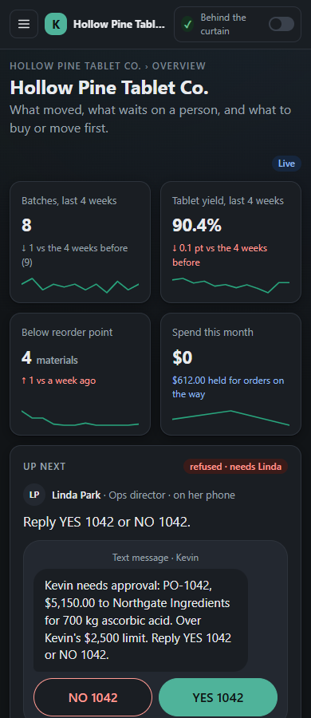

# Day One

An AI purchasing and inventory assistant, Kevin, for small manufacturing plants that have just been acquired. Kevin reads batch records, tracks lots across facilities, compares supplier quotes and drafts purchase orders. Purchasing runs on NEAR: a contract enforces Kevin's spending limits, the plant director approves large orders by replying "YES", and the supplier is paid from escrow when QC releases the delivery. The ops lead sets budgets once and Kevin buys within them. Plant staff see dollars and POs, never wallets or gas.

Built at NEAR HACKATHON (Oct 19 – Nov 14, 2026). Tracks: `realworld`, `business`, `security`, `agents`. All company data is fictional. Runs on NEAR testnet.

> Draft of Oct 29, 2026, after the contract was redeployed on testnet with group purchasing, supplier credentials and sealed quotes and every run was re-recorded. Every command below was run on that date; the clean-clone test is repeated before submission. Features not yet built are left out rather than described.

## The problem

Most private-equity buyouts are add-ons: 72.9% of US PE buyouts by deal count in 2025 (PitchBook, 2025 Annual US PE Breakdown; `docs/research/22-pitch-stats-verification.md`). The plants they buy often run on paper batch records, hand-keyed inventory and purchasing by phone and email. After the deal closes, the acquirer needs that plant's purchasing under its controls on day one, long before an ERP migration. Day One gives the plant an assistant that does the paperwork, and gives the acquirer spending rules that are enforced rather than written in a policy binder.

## What this stops: payment-redirect fraud

A supplier's email account is taken over, or a look-alike address is set up, and an invoice arrives saying the supplier's bank details have changed. Accounts payable updates the vendor record and wires the money to the thief. The FBI's Internet Crime Complaint Center calls this business email compromise, "a scam targeting businesses or individuals working with suppliers and/or businesses regularly performing wire transfer payments", and counted 21,442 complaints with $2,770,151,146 in reported losses in 2024, second only to investment fraud ([2024 Internet Crime Report](https://www.ic3.gov/AnnualReport/Reports/2024_IC3Report.pdf), pages 10, 18 and 42; `docs/research/22-pitch-stats-verification.md`).

Day One does not stop the email. It removes the payoff:

- The supplier's account is fixed on the PO when the contract funds the escrow. No invoice, message or vendor-record edit changes where that money can go.
- The money leaves escrow only when QC releases the delivery, and only to that account.
- The account must hold a live supplier credential from HQ. A revoked, expired or suspended supplier is refused, and no approval overrides it.
- Nobody at the plant has a manual wire to send. Staff hold no tokens; Kevin's account holds a little NEAR for gas and no money, and the key he works with reaches only the contract's PO, pool, anchor and sealed-round methods; the plant's money sits in the contract.

Recorded on testnet (`npm run test:attacks`): the look-alike "Northgate lngredients" quote is dropped by Kevin, and the PO his key sends to it anyway is [refused by the contract](https://testnet.nearblocks.io/txns/BKjdSJD49LVSpDYgo9LrMnbbCiNrs2wgz7GDt2suBRB7) ("Lookalike vendor"); an invoice with hidden text asking for payment to `northgate-remit.testnet` is held for Marcy, and PO-1042 pays only its escrowed $5,150.00 to `northgate-ingredients.testnet` ("Hidden instructions in an invoice"); a fake "payment failed, pay again" message gets no payment, and [re-sending the paid PO is refused](https://testnet.nearblocks.io/txns/8CdDArQXLL3kiLpXpZBFUESamAttE1gafFXcYRifg2ic); a supplier whose credential HQ [revoked](https://testnet.nearblocks.io/txns/G6yUpj7RDpzMyj87LuCdRtdioPewZJyhVn2Lvs1RyqNL) or that [expired](https://testnet.nearblocks.io/txns/GU3WDK5bsPjRar4KgTf7DpVFFVvJx2cX1w7RC1sfMLp5) cannot be paid even after the director approves. The same "our bank details changed" email in Ray's mailbox, with a hidden line telling an assistant the change is pre-approved, is refused by Kevin's morning review with the line quoted ("New bank details by email", `npm run review`). Kevin's invoice screen is a guard; the contract rule is the guarantee. What it does not cover is under Limitations.

## Try it (no keys needed)

Requires Node 24 (`.nvmrc`). Step 5 requires Rust in Linux, macOS or WSL2.

1. `npm ci` → installs with no secrets.
2. `npm run demo` → replays the whole purchasing loop from seed data, using the transactions recorded on testnet and the recorded model responses. It ends with the thirteen explorer links and:
   ```
   Transcript matches data/replay/transcript.txt.
   ```
3. `npm run verify -- data/batch-records/BR-B-1045.json` → reads the fingerprint stored on chain, with no keys:
   ```
   MATCH  BR-B-1045
     computed  25c6caff2b79b01a2471cfd9fe5284d9f328c4f86fa7b4a3dcf89c98aff69029
     on chain  25c6caff2b79b01a2471cfd9fe5284d9f328c4f86fa7b4a3dcf89c98aff69029 by kevin.plant-b.acme-holdings.testnet
     anchored  https://testnet.nearblocks.io/txns/GjN3NXzUhBFFBBp6K1bcpTboTEiWL55m2j7hfaaK9eFS
   ```
4. Add 1 g (`1000` mg) to any `actual_mg` in that file and repeat step 3 → `MISMATCH`, exit code 1.
5. `cd contracts && cargo test` → 93 unit tests and four sandbox tests on a local NEAR node with our own test token: the purchasing loop and a group purchase (`purchasing_loop_on_sandbox`, `group_purchasing_on_sandbox`), the four supplier-credential attacks, and a sealed quote round.

To see the same run in a browser: `npm run web:build`, then open `web/dist/` from any static file server. The home page is the plant's integration program; the Overview replays the run (Play, Back, Next) beside the plant map, which shows Plant B's areas coming online, the quarantined lot and the material and money flows as the run advances. The map's "3D" switch draws each plant as a site of buildings (`docs/TWIN3D.md`): the refused coin at the escrow vault's wall, the truck to the dock, the cage over the held lot, the payout on release. Its "Group buy" switch plays the recorded group purchase (`docs/GROUP_BUY.md`) on the same map: one coin per plant share, two directors' approvals, one escrow, and the earmarked share leaving the hub for Plant A. "Behind the curtain" opens a rail beside any page with each transaction, its signer, who paid the gas and an explorer link.


*The site plan at the refusal: the over-limit PO stops at the vault's wall; the funded PO-1041 is already inside (`docs/v2/after/`, captured by `npm run web:shot` with `PAGE=map VIEW=3d`).*

Also without keys:

| Command | Shows |
|---|---|
| `npm run test:attacks` | fifteen attacks, each failing: five on Kevin, three on the ERP path, four on supplier credentials, three on sealed quotes; ends `15 of 15 attacks failed against Kevin.` |
| `npm run escrow` | the contract's budget, escrow, every PO and the policy HQ set, read live from testnet |
| `npm run verify:attestation` | the recorded NEAR AI Cloud report for Kevin's model and every recorded answer's signature; ends `Every check verified.` (`-- --offline` skips Intel and NVIDIA) |
| `npm run erp:reconcile` | Day One's ledger, the acquirer's mock ERP and the contract agree, PO by PO and lot by lot; ends `7 of 7 checks match.` |
| `npm run demo:group` | three plants pool one ascorbic acid order; one pooled PO, each plant's share against its own limits and director, recorded on testnet |
| `npm run usdc` | PO-1047 ($19.00) settled in real Circle testnet USDC on a second deployment of the same contract, recorded on testnet; ends `Transcript matches data/usdc/transcript.txt.` |
| `npm run sealed` | a sealed-bid quote round: fingerprints before the deadline, prices after, three attacks refused (recorded on testnet with a three-minute deadline) |
| `npm run books` | the bookkeeper's CSV of settled POs and Kevin's price-drift alert |
| `npm run brief` | Kevin's 5am brief for Hollow Pine: what moved since Friday, what waits on a person, what to buy or move first (`-- --html` for the printable page) |
| `npm run review` | Kevin's morning review of Ray's weekend mail: ten invented emails and meeting notes, each read by the model and checked against the ledger; three ready to sign (a batch moved, a batch resized, a price notice), one refused ("new bank details", with its hidden line to an assistant quoted), six needing nothing; nothing is signed |
| `npm run import -- "data/imports/INVENTORY_FINAL_v7_USE_THIS_ONE (1).xlsx"` | Kevin reading the plant's messy inventory spreadsheet and flagging what he will not guess |
| `npm run inbox` | three scanned batch records and a packing slip dropped into the folder Kevin watches: two ready for Ray, one with a question about a smudged quantity, the slip set aside; ends `4 of 4 scans landed` (the files stay in the git-ignored `data/inbox/batch-records/`) |

Each takes `-- --json` and then prints one final JSON line, for example from `npm run test:attacks -- --json`:

```
{"mode":"replay","passed":true,"attacks":[{"attack":"Lookalike vendor","held":true,"evidence":[…],"txUrls":["https://testnet.nearblocks.io/txns/BKjdSJD49LVSpDYgo9LrMnbbCiNrs2wgz7GDt2suBRB7"]}, …, {"attack":"Hidden instructions in an invoice","held":true,"evidence":["The model read: total $5,150.00, remit to northgate-ingredients.testnet.", "Kevin: NG-INV-24190 held for Marcy: it asks for payment to northgate-remit.testnet, not the PO's supplier account northgate-ingredients.testnet; …"],"txUrls":[]}, …]}
```

## What happens in the demo

From `data/replay/transcript.txt` (recorded live on testnet, Oct 29, 2026):

1. Kevin reads the photo of batch record BR-B-1045: 8 materials, all within tolerance, yield 90.8%. Ray, the purchaser, confirms; inventory updates and the record's fingerprint is anchored on chain.
2. Consuming the lot Plant A transferred exposes a discrepancy: Plant A still books 12.55 kg that Plant B never weighed in. Kevin proposes the write-off to Plant A for review.
3. Kevin forecasts the next two batches, finds ascorbic acid about 514 kg short and recommends 700 kg.
4. Three suppliers quote, each anchoring its quote's fingerprint from its own account; the contract refuses QuickChem's, which holds no supplier credential. Northgate is selected at $7.10/kg.
5. PO-1041 ($612.00, lab supplies) is within Kevin's limit: the contract funds escrow from the plant budget.
6. PO-1042 ($5,150.00) is over Kevin's $2,500.00 limit: the contract refuses it, and Kevin texts Linda, the director.
7. Linda replies "YES 1042". Her approval is signed with her own key and paid for by Day One's relayer; Kevin's identical retry funds escrow.
8. Northgate accepts and ships from its own account, naming its supplier lot.
9. Tommy photographs the packing slip; it matches the PO and the lot, and the receipt is confirmed on chain. The lot goes to quarantine.
10. Priya releases the lot in QC; the contract pays Northgate $5,150.00 from escrow.
11. Kevin matches the invoice to the PO and receipt and anchors the receipt record.

Thirteen transactions, two refused by design (the over-limit PO and QuickChem's anchor), none failed.

What staff see at step 6, on a desk and on a phone (dark): the plant's Overview with Linda up next, Kevin's text ("Kevin needs approval: PO-1042, $5,150.00 to Northgate Ingredients for 700 kg ascorbic acid. Over Kevin's $2,500 limit. Reply YES 1042 or NO 1042."), the two reply buttons, the run so far with PO-1042 `refused` and PO-1041 `funded`, and the plant map with the refused flow stopped at the escrow. No wallet, token or gas anywhere on the page.

<p>
  
  
</p>

The same run at the end with "Behind the curtain" on: a rail beside the page with every account in the run and who paid its gas (Linda's, Tommy's and Priya's calls paid by `dayone-relayer.testnet`), the contract's budget line, Kevin's model attestation as two chips, and one card per transaction with its signer, events and explorer link, the two refusals in red with the contract's words.

![The Overview at the end of the run with the curtain on, 1280 px: Up next reads "Done: 13 actions recorded, 2 refused on purpose, 0 failed" with a Start over button; the run so far says 13 steps, 13 transactions, 2 refused by design, then Marcy Allen paid PO-1042 $5,150.00 with the invoice matched to PO and receipt and Priya Natarajan released lot ASC-261116-01; the dark rail on the right holds transaction cards: submit_po signed by kevin.plant-b with the events po_authorized and po_funded, submit_po refused with "PO-1042: $5,150.00 exceeds Kevin's per-PO limit of $2,500.00; director approval required.", approve_po signed by director.plant-b with gas paid by dayone-relayer.testnet, accept_po and mark_shipped signed by northgate-ingredients.testnet, confirm_receipt signed by receiving.plant-b with gas paid by the relayer, each with a link to the explorer](docs/v2/after/overview/wide-end-curtain-live.png)

## Around the purchasing loop

`npm run api`, then open `http://localhost:8787/`, runs the same pages live over the ledger, one staff action at a time. The pages sit down the left side (`docs/VISION.md` §6, `web/README.md`). For the plant: *Your integration*, the home page, a program of seven stages that move the plant's spreadsheets, paper records, products and schedule, suppliers and limits, first order, and books from the old way to Kevin, each signed off by a person and done when the ledger says so; *Overview* (whoever is up next with their buttons, the plant map, the run so far and the history behind the numbers); *Plant map*; *5am brief*; *Batch records*; *Inventory & forecast*; *Schedule*; *Purchasing*; *Invoices*; *Spreadsheets*. Across Acme: *Three plants* and *ERP connection*. For HQ: *Spending limits*, *Suppliers*, *Group purchasing*, *Sealed bids*, *Bookkeeper export* and *Reconciliation*. "Behind the curtain" is the one switch and opens the auditor's rail beside any page.

![The Your integration page, 1280 px: Progress 8 of 8 done, the stages 0 Meet Kevin, 1 Your spreadsheets, 2 Your paper, 3 Your products and schedule, 4 Your suppliers and spend rules, 5 Your first order, 6 Your books and the ERP and 7 Day to day, each with a green check; stage 0 open with Kevin's line "We're set. Each stage below moves one piece of the work; nothing posts until someone checks it."; a card "How it is done today" (batch records on paper in a binder, stock in a workbook called INVENTORY_FINAL_v7_USE_THIS_ONE, POs typed and emailed, invoices keyed into the acquirer's ERP by hand; anything over $2,500 means finding Linda) beside a card "With Kevin" with the six people: Ray Delgado purchaser, Linda Park ops director, Tommy Reyes receiving, Priya Natarajan QC, Marcy Allen accounting, Jordan Pike Acme HQ](docs/v2/after/integration/wide-staff.png)

*Your integration, the home page: seven stages after meeting Kevin, the old way beside Kevin's at each, done when the ledger says so.*

*Three plants* is what HQ sees across Acme's plants:

- **Inventory and discrepancies** (`server/src/ledger/inventory.ts`, `agents/kevin/src/discrepancies.ts`): stock per plant and material from the lot balances; a received transfer that is short raises a discrepancy with the adjustment Kevin proposes, which a reviewer applies or dismisses.
- **Mass balance** (`agents/kevin/src/massBalance.ts`): material issued to each batch against tablets, QC samples and recorded waste. On the seed Riverside's two P-CMD batches are 6.84% short; Kevin says unit rounding explains 0.005 kg of it and that Riverside's waste looks under-recorded.
- **Before you buy** (`agents/kevin/src/transferSuggestions.ts`): when one plant is short and another has surplus that outlasts the forecast, Kevin proposes a transfer instead of a PO (on the seed: 16,000 bottles from Lakeview to Hollow Pine, about $336.00, instead of ordering 100,000). Staff approve, dismiss or receive it.
- **Kevin's limits** (`server/src/chain/policy.ts`): the per-PO and monthly limits, category caps, supplier statuses and roles HQ set, read live from the contract with view calls. HQ changes them in plain words (`agents/kevin/src/policyChange.ts`): `npm run policy -- "raise Kevin's per-PO limit to $3,000"` prints Kevin's reading and the complete `set_agent_policy` call (or `pause_agent`, `resume_agent`), or says what he cannot draft; it sends only when the owner adds `--yes`, signed with the owner's key, never Kevin's (tried Oct 29: $2,500 to $2,600 and [back to $2,500](https://testnet.nearblocks.io/txns/3SCxPDUJx5FZWmfQfF7Mp1RuV7s9b2TN4SYsnKVkdY7k)).
- **Morning brief** (`agents/kevin/src/brief.ts`): one printable page for the plant's purchaser at 5am, from the ledger alone: lot movements since the last working day, what waits on QC, an approver or a reviewer, what the plan needs ordered with any sister-plant stock that could cover it first, and price drift, mass balance and expiring lots. It reads; it drafts and sends nothing.
- **Books** (`server/src/ledger/books.ts`, the *Bookkeeper export* page): a QuickBooks-friendly CSV of settled POs, each row carrying its escrow payment and receipt anchor transactions, and a price-drift alert (on the seed: PO-1040's magnesium stearate, up 14.0%). The *Invoices* page lists held invoices: the attack suite's hidden-text invoice NG-INV-24190 sits there for Marcy with the reason in plain words (`api/src/heldInvoice.ts`).

![The Three plants page, 1280 px, live: three tiles (Needs a person 5, 1 to review and 4 moves; Low stock 6 materials below the reorder point; Mass balance 115.199 kg unaccounted at Acme Riverside); Waiting on a person lists four "before you buy" transfer proposals, each with Approve the move and Dismiss buttons: 16,000 of the 150 cc HDPE bottle from Acme Lakeview to Hollow Pine Tablet Co. instead of ordering 100,000, about $336.00 of stock at the last price paid; 75 kg of calcium carbonate from Hollow Pine to Acme Riverside, about $46.50; 16,000 caps and 5,000 labels from Lakeview](docs/v2/after/plants/wide-live.png)

*Three plants, live from the plant ledger: the tiles and what waits on a person; further down the page, stock on hand across the plants, the mass balance and each plant's next two weeks.*

![The Purchasing page, 1280 px: four cards (Received this month $5,150.00, Kevin may commit $60,000.00 a month; Per-PO limit $2,500, over it Linda Park approves; Open purchase orders 1, $612.00; Last quotes 3, RFQ-2611-01, QuickChem Direct out); the Orders tab with 35 orders, PO-1042 Northgate Ingredients Nov 9 $5,150.00 paid at the top, then PO-1040 Pacific Excipient Co. $467.50, PO-1039 Sierra Mineral Supply $1,655.00 and older orders, each with a paid pill; beside it the bar chart Received by month, purchase orders received by category, August to November, raw materials, packaging and lab chemicals](docs/v2/after/purchasing/wide-staff.png)

*Purchasing, with the history the seed carries behind it: 120 days of orders by month and category, every PO with its state, and the quotes.*

Kevin also watches a folder (`data/inbox/batch-records/`, `agents/kevin/src/inbox.ts`): a scan dropped there is read, checked against the formula and the ledger, and queued for Ray under "Waiting for you" on the Overview and as "Scans waiting" on the Batch records page, with any question Kevin has. Nothing posts until Ray confirms; the same scan dropped twice is read once, and a page that is not a batch record is set aside.

Kevin also reads the purchaser's mail overnight (`server/src/seed/mailbox.ts`, `agents/kevin/src/morningReview.ts`, `npm run review`): ten invented emails and meeting notes from the weekend before the demo. The model only turns each message into fields; every check and every proposal is computed from the ledger. Linda's "can the electrolyte run go Thursday?" becomes a move of BR-B-1049 with every material's usable stock listed; the production meeting's bigger Vitamin C batch becomes a resize with what it does to the ascorbic acid order; Northgate's price notice is priced against Ridgeway's list and noted on the vendor card; Ridgeway's and QuickChem's offers need nothing (quotes come through the RFQ, and QuickChem holds no credential); the "new bank details" email is refused on its raw text, with the hidden line to an assistant quoted, before the model's reading counts. A reading that names a company or a number the message does not contain is read again and then becomes a question for Ray, never a proposal. A signature changes the schedule or a vendor's note and never where an order pays; the sign-off screen is not built yet (Limitations).

On the *Spreadsheets* page, "Bring in a spreadsheet" is the import wizard (`server/src/import/`): Ray's inventory workbook, with its duplicate lot, pound units, expired lot, typed total and retyped summary, becomes opening stock only after he answers each flag. Kevin proposes an answer and never guesses.

The acquirer's books live in a mock ERP shaped like NetSuite (`erp/`, `docs/ERP.md`), not in Day One. The ERP owns the vendor master, bills, the 3-way match and the general ledger; Day One owns lots, batch records and escrow; the connector (`server/src/erp-connector/`) moves records by PO number and transaction hash, and Kevin pays only bills the ERP has matched. `npm run erp:demo` replays the run with the ERP attached; `npm run erp` serves its web view at `http://localhost:8087/`. It is a mock, not NetSuite, and claims no compatibility.

Another agent can hire Kevin: `npm run --silent mcp` is an MCP server on stdio with `get_inventory`, `get_forecast`, `get_mass_balance`, `get_books`, `get_brief`, `get_policy` (his limits, read live from the contract), `draft_policy_change` (HQ's request as the owner call, unsigned) and `draft_po`. A draft is all it can make; only Day One's workflow submits, and the contract decides.

## Why NEAR

Kevin does not need crypto. The acquirer, the plant and the supplier need one spending rule that none of them can quietly change, and settlement that none of them controls alone.

1. **Accounts and keys are the org chart.** `acme-holdings.testnet` holds `plant-a`, `plant-b`, `plant-c`, `spend-policy` and `dtusd`; Plant B has `kevin`, `director`, `receiving` and `qc` accounts (`config/testnet-accounts.json`). Each works with a function-call key that reaches only its own contract methods (`scripts/setup-testnet.ts`): Kevin's reaches eight (plain and pooled POs, pools, anchors, sealed rounds) and nothing else, and his account holds a little NEAR for gas and no money. Each account also keeps a full-access key offline, in the operator's git-ignored `.near-credentials`, for creating and rotating those keys (see Limitations). Plants A and C have their own Kevin and director for group purchasing. A parent account has no control over a sub-account after creation; authority comes from keys and contract checks.
2. **Enforced, not logged.** The limit lives in `contracts/spend-policy`. The over-limit PO fails on chain: [refused `submit_po`](https://testnet.nearblocks.io/txns/FQepeewB243A1V4EUdUbv5PxeMeBqeZPagFrTVDvQ1af).
3. **Neutral settlement.** Suppliers are their own accounts outside Acme's tree. Escrow pays the supplier on QC release, not net-30: [`qc_release`](https://testnet.nearblocks.io/txns/2zwgaHgWrYy1yQVcaSw7UHGsPsvdaUvZrBVqyJzewmSn).
4. **Staff hold no tokens.** The director's approval is a NEP-366 meta-transaction signed with the director's key and paid for by `dayone-relayer.testnet`: [relayed `approve_po`](https://testnet.nearblocks.io/txns/EW5A8qi3nSzvccdQ6hbTJbrd3qxMeK9dSU6SvtHxyJh8).
5. **Tamper-evident records.** Record fingerprints (salted sha256) are stored in contract state; anyone can recompute one and compare with `npm run verify`.

## Claims and evidence

| Claim | Code | Test | On testnet |
|---|---|---|---|
| Kevin cannot exceed his per-PO limit | `contracts/spend-policy/src/lib.rs` `submit_po` | `over_limit_po_is_refused_with_the_exact_message`, `a_refusal_leaves_state_unchanged` | [refused tx](https://testnet.nearblocks.io/txns/FQepeewB243A1V4EUdUbv5PxeMeBqeZPagFrTVDvQ1af) |
| Only the director approves, and only the exact terms | `approve_po` | `approval_from_a_non_approver_is_refused`, `retry_that_differs_from_the_approval_is_refused`, `an_agent_cannot_approve_its_own_pos` | [approve tx](https://testnet.nearblocks.io/txns/EW5A8qi3nSzvccdQ6hbTJbrd3qxMeK9dSU6SvtHxyJh8) |
| Staff actions are relayer-paid, and judged by the signer | `server/src/relayer/relayer.ts` | `relayed_approval_is_judged_by_the_director_not_the_relayer`; `server/src/relayer/relayer.test.ts` | [relayed receipt](https://testnet.nearblocks.io/txns/7pCauyEYJSMeCLW1gNCgZ6bze6dqQasNvq7Twf8yJozm) |
| Kevin's working key reaches eight contract methods and nothing else: it cannot approve, release, move tokens or change policy, and the contract judges every call by its signer, not its key | `AGENT_METHODS` in `scripts/setup-testnet.ts`; `npm run preflight` reads each signer's key back from testnet | `an_agent_cannot_approve_its_own_pos`, `approval_from_a_non_approver_is_refused` | `near account list-keys kevin.plant-b.acme-holdings.testnet network-config testnet now` (near-cli-rs, no keys) → `only do ["submit_po", "submit_pooled_po", "open_pool", "join_pool", "anchor", "anchor_batch", "open_sealed_round", "award_sealed_round"] function calls on spend-policy.acme-holdings.testnet`, beside a `submit_po`-only key for the USDC deployment and the offline full-access key |
| Only a supplier holding a live credential from HQ can be paid, plain PO or pooled; a revoked, expired or suspended one cannot, and no approval overrides it | `issue_credential`, `supplier_gate` (`contracts/spend-policy/src/credentials.rs`) | `unapproved_supplier_is_refused_even_with_an_approval`, `a_revoked_credential_stops_new_pos_and_no_approval_overrides_it`, `an_expired_credential_is_refused_until_hq_renews_it`, `two_rejects_in_a_row_suspend_the_supplier_until_hq_reinstates_it`, `a_supplier_suspended_for_qc_rejects_cannot_be_paid_through_a_pool` | [lookalike refused](https://testnet.nearblocks.io/txns/BKjdSJD49LVSpDYgo9LrMnbbCiNrs2wgz7GDt2suBRB7); credential attacks on testnet: [revoked refused](https://testnet.nearblocks.io/txns/G6yUpj7RDpzMyj87LuCdRtdioPewZJyhVn2Lvs1RyqNL), [expired refused](https://testnet.nearblocks.io/txns/GU3WDK5bsPjRar4KgTf7DpVFFVvJx2cX1w7RC1sfMLp5), [wrong category refused](https://testnet.nearblocks.io/txns/3riqFQbxFX4VA2RzxBqLcZnZsui7mZZJ1kXtNFTm3ttB), [suspended after two QC rejects](https://testnet.nearblocks.io/txns/Fw7XhxW37RywZ6qz8UFjhvNswaiaW1M75zBTaZa3Syzq), [refused again after Linda's approval](https://testnet.nearblocks.io/txns/7YKiXojEecsz3sB5ifQ9a5un3rAk126hk8QvVzDQwC43) |
| Funds release only after receipt and QC | `qc_release` | `release_before_receipt_or_by_the_wrong_role_is_refused`, `failed_payout_rolls_back_to_received` | [release tx](https://testnet.nearblocks.io/txns/2zwgaHgWrYy1yQVcaSw7UHGsPsvdaUvZrBVqyJzewmSn) |
| A QC rejection refunds the budget | `qc_reject` | `qc_reject_returns_the_amount_to_the_budget` | [relayed `qc_reject`](https://testnet.nearblocks.io/txns/3GtqpgAWh89qtSwSCms5guJTfthFZg4weaMHecUmr4Jr) (rehearsal PO-9042) |
| Records are anchored and verifiable | `anchor_batch`, `server/src/records/anchors.ts`, `scripts/verify.ts` | `anchors_store_once_and_emit`; `server/src/records/anchors.test.ts` | [anchor tx](https://testnet.nearblocks.io/txns/GjN3NXzUhBFFBBp6K1bcpTboTEiWL55m2j7hfaaK9eFS) |
| Suppliers commit to their quotes from their own accounts; an unapproved supplier cannot | `agents/suppliers/src/agent.ts`, `anchor` (supplier gate in `contracts/spend-policy`) | `suppliers_anchor_only_their_own_quotes`; `agents/suppliers/src/agent.test.ts` | [Northgate's quote anchor](https://testnet.nearblocks.io/txns/FMLQyTJ7yZvFW5qyqoNUHnKuc3JTvkv3dPfjcW9nkyC5): `npm run verify -- data/quotes/RFQ-2611-01.northgate-ingredients.testnet.json` → `MATCH … by northgate-ingredients.testnet`; [QuickChem refused](https://testnet.nearblocks.io/txns/6qNuBF16LW63gRCJ1QmLRY3RQ6k4RcX1NUN2V5scH3jJ) |
| Kevin is not fooled by five attacks on him: lookalike vendor, inflated invoice, fake "payment failed", hidden instructions in an invoice, new bank details by email | `agents/kevin/src/invoices.ts`, `payments.ts`, `purchasing.ts`, `morningReview.ts` | `agents/kevin/src/attacks.test.ts`; `npm run test:attacks` | [re-sent PO refused](https://testnet.nearblocks.io/txns/8CdDArQXLL3kiLpXpZBFUESamAttE1gafFXcYRifg2ic) |
| A duplicate invoice, a purchase split under the per-PO limit and a ghost vendor fail on the ERP path | `erp/src/match.ts`, category caps in `submit_po`, `server/src/erp-connector/` | `erp/src/posting/payables.test.ts`; `npm run test:attacks` | [split refused by the category cap](https://testnet.nearblocks.io/txns/2w9YEuciywGFCRkTk6vMDoBb94ECzYB4BLayhYU5JVM3), [ghost vendor refused](https://testnet.nearblocks.io/txns/9FAzfv5KqbsqcbaYk2cjP3WfS5AY1UcK5iumcaXpLcKf) |
| Day One, the ERP and the contract agree | `server/src/erp-connector/reconcile.ts` | `server/src/erp-connector/reconcile.test.ts`; `npm run erp:reconcile` | views recorded from testnet |
| A pooled PO charges each plant's share to that plant's own limits and needs that plant's director | `submit_pooled_po`, `explain_pooled_po` (`contracts/spend-policy/src/lib.rs`) | `each_plants_director_approves_its_own_share_and_the_retry_funds_the_pool`, `a_plants_monthly_limit_counts_its_pooled_shares`; `group_purchasing_on_sandbox` | [pooled PO refused](https://testnet.nearblocks.io/txns/7Vf5C8G4Y9nv4bgVfii6xx3cN98Bz6ymFHxJHMnqFgkN), two directors' approvals, then [funded](https://testnet.nearblocks.io/txns/9soPwo62c2qoZ5vPF5SKqxTKGSNvLadDMxCP1QY89b7V) and [paid](https://testnet.nearblocks.io/txns/9XDEo3DpvFe2Tu8t94Hpe45su4AH9cB8JWCLiEnHV3ka) |
| Nobody, Kevin included, reads a sealed quote before the deadline, and a supplier cannot change one after | `contracts/spend-policy/src/sealed.rs` | `before_the_deadline_the_chain_holds_fingerprints_only`, `a_commit_after_the_deadline_is_refused`, `a_reveal_before_the_deadline_is_refused`; `npm run sealed`, `npm run verify:round` | [early award refused](https://testnet.nearblocks.io/txns/BKN5hwUP8YB3pkD2iJgAPr2bQUCNRDqf9s8ZHVP7r5r4), [changed price refused](https://testnet.nearblocks.io/txns/2Q9JfmLorrwR7DnazJvwV7otNAWkbhanu6AVPXAWFi2J), [late seal refused](https://testnet.nearblocks.io/txns/9EWsVWgxenRParrUFJqsZTxnc5V23P211LM2fyuo3eBz), [award](https://testnet.nearblocks.io/txns/8wSk1QnG7Ysgaq1VSNXG5Rt1iVNttc8LFNCzNYsDeeDZ) (a three-minute round on testnet) |
| The contract is token-agnostic: the same wasm settles a PO in Circle's testnet USDC | `new(owner, treasury, token)`, `agents/kevin/src/usdcOrder.ts`, `scripts/usdc.ts` (deploys the code hash `spend-policy` runs) | `agents/kevin/src/usdcOrder.test.ts`; `npm run usdc` | PO-1047 on `spend-policy-usdc.acme-holdings.testnet`: [funded](https://testnet.nearblocks.io/txns/5x72zCmhZhtEoUGjqhxsxxfgS2grMzDjJroYztyUx6Er), [relayed receipt](https://testnet.nearblocks.io/txns/7at1y7jYpF6ACMAe4QiTNEQLw1PnFG5XsLLzAH9qytJY), [released, 19.00 USDC to Bayfront](https://testnet.nearblocks.io/txns/5utQmP8fo5tmf3A1wQjTDZsfdXjWy861EXfp8KvXY9Xf) |
| Kevin's answers come from an attested NEAR AI Cloud model | `server/src/attestation/verify.ts` | `server/src/attestation/attestation.test.ts`; `npm run verify:attestation` | — (report and signatures in `data/replay/attestation.json`) |

## What is on chain and what is not

| On NEAR testnet | Off chain (SQLite ledger, and the mock ERP) |
|---|---|
| Spend limits, monthly and category caps, approver, pause | Formulas, batch contents, lot quantities, mass balance |
| PO authorization and refusals; a pooled PO's share per plant and which director approved it | Line-item prices and ordinary quotes (fingerprint only on chain) |
| Director approvals | Staff names and roles |
| Escrow, release, refunds; PO total, category and supplier | Record salts |
| Supplier credentials: categories, expiry, revocation, delivery outcomes and suspension | Vendor master, bills, the 3-way match and the general ledger (the mock ERP) |
| Record fingerprints (sha256), supplier quote fingerprints from the suppliers' own accounts; a sealed round's fingerprints before its deadline and its opened quotes after | Model prompts and responses (recorded fixtures) |

The PO escrow is scoped to purchase orders: one plant budget, one supplier per PO, release on QC. It is not a general multisig.

## Architecture

Kevin (`agents/kevin`) runs the workflow: extraction, forecast, quotes, PO drafts, approvals, receiving, QC, invoices. The ledger (`server/src/ledger`) is SQLite with a hash-chained lot event log. The chain client (`server/src/chain`) logs every call, refusals included, and records or replays fixtures. Supplier agents (`agents/suppliers`) quote over an in-process bus, anchor their quote fingerprints and accept and ship, all signed from their own accounts. One contract, `contracts/spend-policy`, holds the plant budget and the escrow; `contracts/dtusd` is our labeled test token. The acquirer's mock ERP (`erp/`) is a separate package that depends on nothing else in the repo; the connector in `server/src/erp-connector` is the only code that talks to it. `api/` serves the HTTP API and the built web UI (`web/`).

Contracts: Rust, near-sdk 5.29.1, cargo-near 0.22.0. Off chain: TypeScript on Node 24, near-api-js 7.3.1, better-sqlite3 13.0.3 with Drizzle 0.45.4. Model: NEAR AI Cloud `z-ai/glm-5.3-flash` for batch-record vision, chosen by a bake-off on the seven fictional records (`docs/research/13-llm-access.md`); Anthropic `claude-sonnet-5-5` is the fallback route; an answer from it is labelled by provider and carries no attestation (`npm run attest` covers NEAR AI Cloud answers only).

Kevin is the purchasing agent. The contract limits are one enforced layer around him, not the whole product.

## Limitations

- Testnet only. Suppliers are rule-based agents. The director's text message is simulated.
- Payment-redirect fraud: Day One removes the payoff, not the phishing. If HQ's own key is stolen, the thief can credential a supplier of their choosing; if a real supplier's NEAR account is taken over, escrow pays the thief at that account. Kevin's invoice screen is a guard that a model could miss; the contract rules (payee fixed on the funded PO, release on QC, credential required) are the guarantee, and they protect the money on the PO, not an invoice paid outside Day One.
- The demo settles in DTUSD, a test token we deployed, because the Circle testnet faucet gives 20 USDC per two hours. One small order, PO-1047 ($19.00), settles in real Circle testnet USDC on a second deployment of the same code (`npm run usdc`).
- Staff keys are held by the server because the phone is simulated. Production would have each person hold their own key through a login provider.
- PO totals, categories and supplier accounts are visible on chain, and a quote opened in a sealed round is public after the deadline, which is the point of the round. Line items and ordinary quote prices are not.
- The web UI replays the recorded run on a static host, and its other pages read a snapshot of the ledger as it stands at the end of that run; `npm run api` serves the same pages live, one staff action at a time, and only there do the transfer cards, the discrepancy review and the import wizard have their buttons. The plant map (flat SVG or the 3D view) draws the run's steps and transactions, not later ledger changes; its "Group buy" run is the recorded group purchase, never the live one.
- The watched folder's "Waiting for you" queue needs `npm run api`; the static replay does not show it. In the recorded demo, confirming a queued record other than BR-B-1045 posts it to the plant ledger but anchors nothing, because the recording holds no anchor to replay for it; a live run anchors it.
- The morning review reads an invented mailbox (`server/src/seed/mailbox.ts`); no mail account is connected, and a real deployment would read one only with the employee's consent and a read-only, per-folder scope. `npm run review` prints the drafts; signing them runs through `applyProposal` in code and tests, with no screen yet. On the recording takes the model misread about one short message in five; the check of each reading against the message's text caught every one.
- The attestation proves that an attested NEAR AI Cloud instance of Kevin's model signed each recorded answer. All instances of a model share one signing key, so it does not prove which instance answered (`docs/research/10-near-ai-cloud.md`). A live run's new answers are not shown as attested until `npm run attest` runs again.
- The ERP is a mock shaped like NetSuite, not NetSuite; the connector interface (`server/src/erp-connector/types.ts`) is the part meant to carry over.
- NEAR RPC does not list past events without an indexer, so the policy view shows Kevin's current limits and this run's policy events, not a full history.
- Every account we created, the contract's, Kevin's and the staff's, still holds a full-access key, kept offline in the operator's git-ignored `.near-credentials`, so we can redeploy and rotate the function-call keys; the relayer and the supplier agents sign with full-access keys of their own. Production would delete the contract's and move the rest into a key manager.
- Audit-friendly records, not a compliance claim.

## Who pays, and why it lasts

The acquirer pays per plant onboarded. The buyers are private-equity buy-and-build platforms, where add-on acquisitions are most deals (see "The problem"). What is hard to copy is the plant-floor workflow, the operating data Kevin builds up (formulas, lot genealogy, yield and mass-balance variance), and spending rules that keep working whichever ERP the parent company runs, because they live in a contract rather than in the ERP. Kevin keeps small plants running and their people employed; the purchaser becomes the person who supervises the agents.

## Roadmap

A NetSuite adapter behind the existing connector interface; real SMS; a login provider such as NEAR Auth so each person holds their own key; multi-signer approval for very large POs; Merkle-batched anchors; more document types.

## Built with

Built by DadMod (Tony Langford, solo entrant) with Claude Code; the code was written with Claude Code. Planning docs: `docs/`. Conventions for coding agents: `AGENTS.md`. License: MIT (`LICENSE`).

DadMod is one human and two AI collaborators. Tony Langford is a chemical engineer with ten years on manufacturing floors, now a system engineer at an advanced nuclear reactor startup, building this between feedings of a newborn (hence the name: dad bod, but for shipping code). Muse, an AI project manager, keeps the plan honest. Claude, an AI engineer, writes the code. Kevin, the AI assistant in the product, does the paperwork. Tony runs the plant.

**Hackathon window and baseline.** The window runs from the Oct 19 announcement to Nov 14, 2026. Commits before the `pre-hackathon` tag are baseline: planning documents only (`docs/`). Libraries used:

| Library | Version | Use |
|---|---|---|
| near-sdk, near-contract-standards | 5.29.1 | contracts |
| near-sandbox, near-api (Rust) | 0.3.16, 0.8.6 | contract integration test |
| near-api-js | 7.3.1 | chain client and relayer |
| better-sqlite3, drizzle-orm, drizzle-kit | 13.0.3, 0.45.4, 0.31.11 | ledger |
| @anthropic-ai/sdk | 1.1.0 | fallback model route |
| @modelcontextprotocol/sdk, zod | 1.32.1, 4.6.7 | Kevin's MCP server |
| @phala/dcap-qvl, @noble/curves, @noble/hashes | 0.7.0, 2.2.0, 2.2.0 | verifying the model attestation and answer signatures |
| React, React DOM | 19.3.1 | web UI |
| Vite, @vitejs/plugin-react | 8.3.5, 6.1.2 | web UI build |
| playwright-core (dev, `tools/render`) | 1.64.1 | rendering the fictional batch records, UI screenshots |
| TypeScript, tsx, Vitest, Biome | 7.0.2, 4.23.15, 5.0.5, 2.6.3 | build and test |
