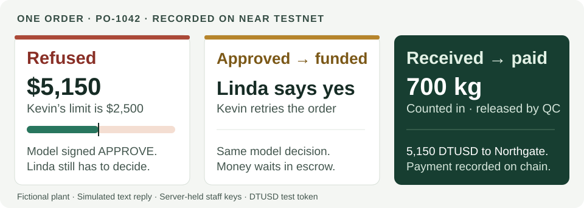
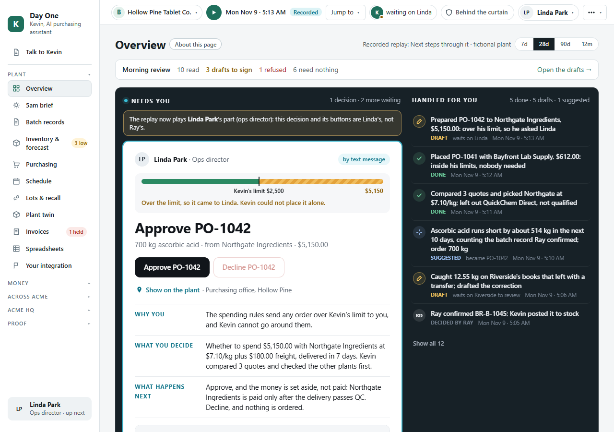

# Day One

**Bring a newly acquired factory’s purchasing under the new owner’s spending rules, before the ERP migration.**

Meet Kevin, the AI purchasing and inventory assistant. He reads the plant’s paper records, works out what to buy and compares suppliers. Staff supervise the work. A NEAR contract controls purchasing authority and holds the order’s money through receipt and QC.

Acme has just bought Hollow Pine. Ray still has a plant to run. Here is one order from his first week.

<picture>
  <source media="(max-width: 600px)" srcset="docs/readme/order-proof-phone.svg">
  
</picture>

[See the refusal](https://testnet.nearblocks.io/txns/3bYd13vyu89wuD299y6gvmZMu1rV1vbBGQpKVEZdp1UC) → [Linda’s approval](https://testnet.nearblocks.io/txns/FpXXzZBkeCNouQgJn7eF8k7oe57dzgd3n21yhvFzGAtt) → [Funded retry](https://testnet.nearblocks.io/txns/3TzgR7iY2zrbYHvnbNphFfeJJaLQwLi4tPfGkQCH1oee) → [QC release and payment](https://testnet.nearblocks.io/txns/3F2TYKZ1bZPsKmrNt5aqJSQi49RaN9wTMUYdXDr1Hd6e)

**Kevin’s model had already signed APPROVE. The contract still required Linda’s approval.** Both attempts carried the same signed model response. Linda’s authorization let Kevin fund the order. Northgate received payment after Tommy confirmed receipt and Priya released the lot. The staff screens show the order, the decision and what happens next. [Recorded calls and their signers](PROOF.md#the-purchasing-loop-po-1041-and-po-1042)

[Replay the order](#try-it-no-keys-needed) · [Check the claims](#claims-and-evidence) · [Explore the layers](#layer-index) · [Limits of the demo](#limitations)

## Try it (no keys needed)

Use Node 24 (`.nvmrc`). From the repo root, the first two steps replay the order above. Installation needs internet. The replay uses the committed model answers and testnet transactions.

1. `npm ci` → install dependencies.
2. `npm run demo` → follow the batch record, shortage, quotes, approval, delivery and payment. It ends with `Transcript matches data/replay/transcript.txt.`

To inspect the evidence further, continue with these steps. Verification reads NEAR testnet and needs internet. Rust tests need Linux, macOS or WSL2.

3. `npm run verify -- data/batch-records/BR-B-1045.json` → `MATCH  BR-B-1045`, comparing the record’s fingerprint with its on-chain anchor.
4. Copy that file, add 1 g (`1000` mg) to one `actual_mg` in the copy, and verify the copy → `MISMATCH`, exit code 1.
5. `cd contracts && cargo test` → contract unit tests and purchasing, credential and sealed-round tests on a local NEAR sandbox.

**Open the replay in a browser.** Run `npm run web:build`, then `npm run web`. Open [the refusal](http://localhost:5173/?judge=3) for the moment above, or [the full walkthrough](http://localhost:5173/?judge=1) from the plant handover. Vite prints the actual local address if that port is occupied. The [captioned tour](http://localhost:5173/?video=1&tour=1) follows the recorded flows. For staff actions such as confirming scans and signing mailbox drafts, use `npm run api` after the build and open [the local app](http://localhost:8787/). [Replay and API behavior](docs/HOSTING.md)

**Run the evidence scorecard.** `npm run prove` checks the replay, record integrity, attack cases, model signatures, lot passport, mock ERP reconciliation and more. It prints PASS or FAIL with a cause for each claim. It also runs lint, typecheck and TypeScript tests. `-- --quick` skips that code check, and `-- --contract` adds Rust tests. The anchor, lot and sealed-round comparisons make read-only testnet calls. A failed RPC read is reported as a failed check.

For machine-readable results, use `npm run --silent prove -- --json`. The [reviewer map](llms.txt) points to the code and its trust boundaries. [PROOF.md](PROOF.md) lists each recorded transaction with signer, gas payer, events and explorer link. The scorecard’s [claim definitions](scripts/lib/prove.ts) say exactly what each check tests.

More replay commands and record checks

| Command | Shows |
|---|---|
| `npm run test:attacks` | Recorded holds, refusals and reduced settlement. Ends `21 of 21 attacks failed against Kevin.` |
| `npm run ask` | Answers with record citations and signatures. Ends `6 of 6 questions answered.` |
| `npm run escrow` | Current testnet budget, escrow, POs and policy. Needs internet. |
| `npm run verify:attestation` | Model report and recorded answer signatures. `-- --offline` uses recorded Intel and NVIDIA verdicts. |
| `npm run lots` | Checks the lot book’s roots, records and genealogy. |
| `npm run verify:lot -- ASC-261116-01` | Checks receipt, QC and payment against the lot’s day root on testnet. `-- --offline` checks local paths only. |
| `npm run erp:reconcile` | Compares the ledger, mock ERP and recorded chain views. Ends `7 of 7 checks match.` |
| `npm run demo:group` | PO-G-2001, two plants and two directors. Each share is $4,745 of the $9,490 total. Lakeview stays out. |
| `npm run usdc` | PO-1047 pays 19.00 Circle testnet USDC on the earlier contract version. |
| `npm run sealed` | The recorded commit-and-reveal round and three attack scenarios. |
| `npm run verify:round -- data/sealed/RFQ-2611-02.round.json` | Checks the round’s commitments, reveals and timing, then compares with testnet. |
| `npm run brief` | The plant’s morning brief and suggested buying and transfers. `-- --html` produces a printable page. |
| `npm run review` | Ten invented messages yield three drafts to sign, one refusal and six needing nothing. |
| `npm run books` | A CSV of settled POs and the price-drift alert. |
| `npm run import -- "data/imports/INVENTORY_FINAL_v7_USE_THIS_ONE (1).xlsx"` | Reads the fictional workbook and flags questions for a person. |
| `npm run inbox` | Drops demo scans into the watched folder. Ends `4 of 4 scans landed`. |
| `npm run world -- --check` | Regenerates the seeded histories and compares them with the committed files. |

## What happens in the demo

Ray confirms Kevin’s reading of batch record BR-B-1045. Ascorbic acid falls from 722.4 kg to 310 kg, below the plant’s 500 kg reorder point. Kevin checks the production plan and the other plants, compares three quotes, excludes the unqualified supplier and prepares PO-1042 for 700 kg. He has already placed a $612 lab-supply order within his authority. The $5,150 order comes to Linda. [Replay transcript](data/replay/transcript.txt)

Linda approves, Kevin funds escrow and Northgate ships. Tommy reports receipt, the invoice is recorded, and Priya’s QC release causes payment to the supplier fixed on the order. The main run uses DTUSD, a labeled test token. Its story takes place Nov 9–16, 2026. Its transactions were recorded Nov 4 UTC. [Full purchase proof](PROOF.md#the-purchasing-loop-po-1041-and-po-1042)

## Claims and evidence

These are the checks behind that order. Follow the transaction to inspect what the contract did, or run the script to replay it. Unit tests exercise additional conditions. UI locations refer to the local walkthrough above.

| Claim | Test or script | Recorded testnet evidence | Where to see it |
|---|---|---|---|
| The contract refused PO-1042 over Kevin’s limit and funded it after the designated director approved | `npm run demo`, [approval tests](contracts/spend-policy/src/tests.rs) | [Refusal](https://testnet.nearblocks.io/txns/3bYd13vyu89wuD299y6gvmZMu1rV1vbBGQpKVEZdp1UC), [approval](https://testnet.nearblocks.io/txns/FpXXzZBkeCNouQgJn7eF8k7oe57dzgd3n21yhvFzGAtt), [funding](https://testnet.nearblocks.io/txns/3TzgR7iY2zrbYHvnbNphFfeJJaLQwLi4tPfGkQCH1oee) | Judge steps 3–4 |
| A valid model signature accompanied both attempts. The contract checks the registered signer and the supplied PO fingerprint | `npm run verify:attestation -- --offline`, [signature tests](contracts/spend-policy/src/tests/settlement.rs) | [Funded call carrying the decision](https://testnet.nearblocks.io/txns/3TzgR7iY2zrbYHvnbNphFfeJJaLQwLi4tPfGkQCH1oee). Wrong-key and wrong-fingerprint refusals are unit tests. | Judge steps 3–4, behind the curtain |
| The relayer pays staff gas, while the contract checks the receiving and QC roles | `npm run demo`, `npm run test:attacks`, [relayer tests](server/src/relayer/relayer.test.ts) | [Relayed receipt](https://testnet.nearblocks.io/txns/228jQM7vLL8cADCN9YkLBbLQvRcMUJeuoSi9ZLbQVubz), [supplier’s self-release refused](https://testnet.nearblocks.io/txns/EKRLbt4BEmyG7kPn2v3nejckYr8aZcqtXKyvqGFnpMWz) | Judge step 5, Attack arena |
| A plain v2 PO with an ordered quantity can pay less for a short delivery. A recorded invoice can cap payment further | `npm run test:attacks`, [settlement tests](contracts/spend-policy/src/tests/settlement.rs) | PO-T9602 ordered 100 kg and received 50 kg, invoiced in full. [355 DTUSD paid, 355 returned](https://testnet.nearblocks.io/txns/7At9Ynuwyg5QcvzVWuHfQFHdFquy76Kob4apReYJtbZX). A lower invoice is covered by a unit test. | Every proof → Short delivery |
| A funded PO pays its fixed supplier account. The suite stops 21 recorded attack scenarios across the app, mock ERP and contract | `npm run test:attacks`, [attack tests](agents/kevin/src/attacks.test.ts) | [Lookalike supplier refused](https://testnet.nearblocks.io/txns/F6vWEEvk2xZ9AU6MEQHxDP1HLFNYdmUYzP8cwrUmGWFZ). The bank-details email is held before any transaction. [All attack evidence](data/proof-points.json) | Attack arena, Morning review |
| The receipt, QC release and payment for lot ASC-261116-01 can be checked against its anchored day root | `npm run lots`, `npm run verify:lot -- ASC-261116-01`, [lot tests](server/src/lots) | [Root covering the lot’s three records](https://testnet.nearblocks.io/txns/7ioGtdSz5V9bZuh7R67F5iZs9jX5Tb1uQ9Nq78FXfcK4) | Judge step 6, Lots & recall → Prove it |

The contract checks the approval’s supplier, amount, category and supplied fingerprint under the PO ID. **It trusts Kevin’s code to bind the submitted terms to that fingerprint.** Quantity is a separate input. A test demonstrates that an altered quantity with the same approved fingerprint is accepted by v2. Settlement also relies on the staff’s reported count and QC decision. [Executable boundary test](contracts/spend-policy/src/tests/settlement.rs), [complete limits](#limitations)

## Why NEAR

The same order crosses company and role boundaries. Kevin submits it from the plant’s agent account, Linda authorizes it through a relayed transaction, Northgate accepts and ships from its own account, and receipt and QC come from separate staff accounts. The spend-policy contract holds the budget and escrow, enforces those roles and releases payment. Every stage above has a recorded contract result. [Signers and gas payers](PROOF.md#the-purchasing-loop-po-1041-and-po-1042)

NEAR AI Cloud supplies the signed model response, and the contract recovers its signer with `env::ecrecover`. HQ registers that address after off-chain attestation verification. The record fingerprint stays with the lot after payment, so a reviewer can check its history later. [Signature verification](contracts/spend-policy/src/attest.rs), [lot proofs](server/src/lots)

## How far it goes

| Layer | What is built | Run the proof | Evidence and screen |
|---|---|---|---|
| Plant intake and planning | Spreadsheet import, batch-record vision, review questions, forecast, suggested transfers and morning mail drafts | `npm run demo`, `npm run import -- "data/imports/INVENTORY_FINAL_v7_USE_THIS_ONE (1).xlsx"`, `npm run review`, `npm run brief` | [Batch record anchor](https://testnet.nearblocks.io/txns/6s1dZ5pxjB8vLwdQge7VPXF6bqeeuU4uh87podFzJQao). Parsing, planning and mail review operate locally on fictional fixtures. Spreadsheets, Overview, Inventory. |
| Supplier controls and pooled buying | HQ credentials, QC suspension, suppliers anchoring quotes, commit-and-reveal rounds and each plant approving its pooled share | `npm run test:attacks`, `npm run sealed`, `npm run demo:group` | [Credential refusals and suspension](PROOF.md#supplier-credentials), [sealed-round transactions](PROOF.md#sealed-quote-round-rfq-2611-02), [both directors’ approvals and pooled payout](PROOF.md#group-purchase-po-g-2001). Suppliers, Sealed round, Group buy. |
| Settlement in another token | PO-1047 paid 19.00 Circle testnet USDC on a separate deployment of the earlier contract | `npm run usdc` | [19.00 USDC payout](https://testnet.nearblocks.io/txns/5utQmP8fo5tmf3A1wQjTDZsfdXjWy861EXfp8KvXY9Xf). Every proof → USDC. |
| Traceability and books | Lot passports, a recall drill and seven reconciliation checks across the ledger, mock ERP and recorded chain views | `npm run lots`, `npm run erp:reconcile`, `npm run books` | [Lot-root transactions](PROOF.md#lot-book-one-anchored-root-per-plant-per-day), [matched PO-1042 payment](https://testnet.nearblocks.io/txns/3F2TYKZ1bZPsKmrNt5aqJSQi49RaN9wTMUYdXDr1Hd6e). Recall and reconciliation run locally. Lots & recall, ERP connection. |
| Model provenance and plant context | Signed recorded answers with citations, deterministic twelve-month histories and a 3D plant twin showing the replay | `npm run ask`, `npm run verify:attestation -- --offline`, `npm run world -- --check` | [Attestation report and answer signatures](data/replay/attestation.json). History is seeded, and the twin visualizes app state. Talk to Kevin, Inventory, Plant twin. |

## Limitations

- **Prototype and tokens.** All companies, people, prices and records are invented. All transactions are on NEAR testnet. The main and pooled runs use DTUSD. The separate Circle testnet USDC run uses the earlier contract, before quantity settlement and signed decisions. The old DTUSD deployment also remains readable. [Deployment evidence](PROOF.md)
- **People and authority.** SMS is simulated and the server holds staff keys. Suppliers are rule-based agents. HQ chooses policies, authorized roles, supplier credentials and model signer addresses. Operator-held full-access keys remain on accounts. Those keys and HQ are trusted. [Account design](docs/CONTRACTS.md)
- **Approval and model scope.** The contract compares specified approval fields and checks the signed response against a supplied PO fingerprint. It does not reconstruct the PO’s fingerprint from its terms. The quantity-binding case above demonstrates the consequence. Plant B’s plain-PO policy requires a signed decision above $2,500. Pooled POs use their own approval path. Model signatures establish provenance, and the model’s inputs still come from Kevin. The provider uses a model-wide signing key. [Contract checks](contracts/spend-policy/src/lib.rs), [boundary test](contracts/spend-policy/src/tests/settlement.rs)
- **Receipt and settlement.** Staff report counts and QC results. Quantity settlement applies when a plain PO includes an ordered quantity. An invoice caps payment when recorded. Pooled POs take neither quantity nor invoice and pay in full on release. The packing slip’s fields come from a prepared fixture. Batch-record vision is recorded. [Settlement implementation](contracts/spend-policy/src/lib.rs), [receiving workflow](agents/kevin/src/receiving.ts)
- **Supplier and ERP boundaries.** Credentials gate new funding. Revocation does not change an already funded PO’s payee or block its QC payout. A compromised supplier account still receives its payment. The ERP is a mock and its bill match is outside the contract’s payment conditions. [Credential rules](contracts/spend-policy/src/credentials.rs), [ERP connector](server/src/erp-connector)
- **Public evidence.** Transaction arguments are public, including refused reveals in sealed rounds. On-chain data includes PO totals, supplier accounts, submitted quantities, signed decision text and revealed sealed quotes. The PO escrow is scoped to purchasing. General multisig functionality is outside its scope. Kevin is the purchasing agent, with spending limits as one enforced layer of his workflow. [Contract specification](docs/CONTRACTS.md)
- **Records and replay.** The lot-book history is seeded, with daily roots anchored together. Proofs establish integrity since anchoring. The static UI replays recordings and ledger snapshots. Live ledger actions require the API. Talk to Kevin replays six questions, while new questions require a model connection. The mailbox is invented. Generated history and modeled cash, fees and savings are labeled in the UI. These are audit-friendly records with no compliance certification or validated customer ROI. [World model](docs/WORLD.md), [money model](docs/MONEY.md)

On-chain and off-chain data

## What is on chain and what is not

| On NEAR testnet | In the application and mock ERP |
|---|---|
| Policy, roles, approvals, supplier credentials, escrow and payment results | Staff interface, vendor master, bill matching and general ledger |
| PO total, supplier, category, supplied fingerprint, optional quantities and invoice, signed decision text | PO line items, model inputs, ordinary quote records and their salts |
| Record fingerprints and daily Merkle roots, sealed-quote commitments and reveals | Batch contents, lot genealogy, forecast, generated history and the underlying lot records |

Architecture and next steps

## Architecture

Kevin’s TypeScript workflow connects a SQLite plant ledger, NEAR AI Cloud, supplier agents and a Rust spend-policy contract. The React UI reads exported recordings or the HTTP API. The mock ERP sits behind a connector interface. [Architecture](docs/ARCHITECTURE.md), [contract specification](docs/CONTRACTS.md), [ERP design](docs/ERP.md)

## Who pays, and why it lasts

The intended buyer is the acquirer, paying per plant for onboarding and ongoing purchasing support. The product starts with the plant’s existing paperwork and makes purchasing authority explicit while the acquirer works through integration. The fee and savings shown in the demo are modeled. [Product brief](PROJECT_BRIEF.md), [money assumptions](docs/MONEY.md)

## Roadmap

Bind all submitted PO terms to the authorized fingerprint in a versioned contract upgrade, with new evidence. Add a real ERP adapter, staff-held keys through login, SMS, quantity settlement for pooled orders and nightly lot-book anchoring. [Quantity boundary test](contracts/spend-policy/src/tests/settlement.rs), [open product decisions](docs/OPEN_QUESTIONS.md)

## Built with

Built for NEAR HACKATHON by DadMod, Tony Langford’s solo entry, for the realworld, business, security and agents tracks. Tony is a chemical engineer with ten years on manufacturing floors, now a systems engineer at an advanced nuclear reactor startup, building this on paternity leave.

Claude Code built the application. Muse assisted with early planning. GPT-6 Astra contributed design and review passes, then implemented this README, evidence visual, judge-facing copy and contract boundary test with Tony’s authorization. Tony directs the product and approves decisions. [Design passes](docs/astra/INDEX.md)

Day One is a separate project from the same team’s other hackathon entry, [Everstreet](https://github.com/CoderofVibes/everstreet), a platform to build, run and sell a digital business. The projects share no code, data, accounts, or deployments. Receipt-based settlement and the contract-checked enclave signature were prompted by ideas in public hackathon work and implemented from Day One’s own data model. [Implementation history](docs/REFERENCE_IDEAS_PLAN.md)

The build window runs Oct 19–Nov 14, 2026. The `pre-hackathon` tag marks the planning-only baseline. [MIT license](LICENSE)

Libraries and versions

| Library | Version | Use |
|---|---|---|
| near-sdk, near-contract-standards | 5.29.1 | contracts (built with cargo-near 0.22.0; `env::ecrecover` from near-sdk's `unstable` feature) |
| near-sandbox, near-api (Rust) | 0.3.16, 0.8.6 | contract integration test |
| near-api-js | 7.3.1 | chain client and relayer |
| better-sqlite3, drizzle-orm, drizzle-kit | 13.0.3, 0.45.4, 0.31.11 | ledger |
| @anthropic-ai/sdk | 1.1.0 | fallback model route |
| @modelcontextprotocol/sdk, zod | 1.32.1, 4.6.7 | Kevin's MCP server |
| @phala/dcap-qvl, @noble/curves, @noble/hashes | 0.7.0, 2.2.0, 2.2.0 | verifying the model attestation and answer signatures |
| React, React DOM | 19.3.1 | web UI |
| three, @react-three/fiber, @react-three/drei | 0.186.1, 9.8.2, 10.7.9 | the plant twin |
| Vite, @vitejs/plugin-react | 8.3.5, 6.1.2 | web UI build |
| playwright-core (dev, `tools/render`) | 1.64.1 | rendering the fictional batch records, UI screenshots, the tour check |
| TypeScript, tsx, Vitest, Biome | 7.0.2, 4.23.15, 5.0.5, 2.6.3 | build and test |

