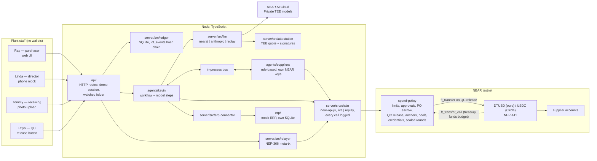

# Architecture — Day One

Decisions here come from `docs/research/`. Each section names the research file that backs it. Versions were checked against `package-lock.json` and the Cargo manifests on 2026-10-29; the README's "Built with" list is kept to the same numbers.

---

## 1. Stack

| Layer | Choice | Version | Research |
|---|---|---|---|
| Runtime | Node.js LTS | 24.22.1 (`engines: >=22.13`, `.nvmrc`) | 18 |
| Language (off-chain) | TypeScript, one npm workspace monorepo (`server`, `agents/kevin`, `agents/suppliers`, `api`, `web`, `erp`) | TypeScript 7.0.2; Biome 2.6.3; Vitest 5.0.5 | 15 |
| Web | Vite + React + SVG for the plant map; no chart library | React 19.3.1, Vite 8.3.5 | 16 |
| 3D twin | three + @react-three/fiber + drei, procedural geometry only (`web/src/twin3d`, `docs/TWIN3D.md`) | 0.186.1 / 9.8.2 / 10.7.9 | 16 |
| HTTP API | Node's own `http` module, no framework (`api/`) | — | — |
| Ledger | SQLite via better-sqlite3 + Drizzle ORM | 13.0.3 / 0.45.4, drizzle-kit 0.31.11 | 18 |
| NEAR client | near-api-js (single v7 package) | 7.3.1 | 06, 08 |
| NEAR CLI | near-cli-rs (setup, deploy and HQ's own calls, signed from the OS keychain) | 0.30.1 | 05, 08 |
| Contracts | Rust near-sdk, built with cargo-near, **in WSL2 Ubuntu** | `=5.29.1` / 0.22.0 | 08 |
| Contract tests | near-sdk unit tests + near-sandbox integration tests (WSL2) | near-sandbox `=0.3.16` | 08 |
| LLM (default) | NEAR AI Cloud, Private TEE models, called over its OpenAI-compatible HTTP API with `fetch` (no SDK); model `z-ai/glm-5.3-flash`, chosen by the bake-off | — | 10, 13 |
| LLM (fallback) | Anthropic API; answers are labelled by provider and carry no attestation | `@anthropic-ai/sdk` 1.1.0; `claude-sonnet-5-5` | 13 |
| Schemas | zod | 4.6.7 | 15 |
| Attestation verify | Phala dcap-qvl (Intel's collateral and NVIDIA's verdict fetched live; `--offline` shows the recorded verdicts) | `@phala/dcap-qvl` 0.7.0 | 10 |
| Kevin as an MCP server | `@modelcontextprotocol/sdk` over stdio (`npm run mcp`) | 1.32.1 | — |
| Batch-record and packing-slip rendering | HTML templates → JPEG with playwright-core driving the installed Edge (`tools/render`, its own small install) | playwright-core 1.64.1 | 14 |
| Spreadsheet import | Our own `.xlsx` reader on `node:zlib` (`server/src/import/xlsx.ts`); CSV too | — | — |
| Stablecoin | Our labeled DTUSD (NEP-141, 6 decimals) for the main run; Circle testnet USDC on a second deployment of the same contract for PO-1047 | see `CONTRACTS.md` §2 | 01 |

**Why two environments:** off-chain code runs on native Windows Node. Contracts build and test in WSL2 because the NEAR sandbox has no Windows binary and cargo-near ABI generation fails under MSVC (research 08). Source stays on `C:\Dev`; `CARGO_TARGET_DIR` lives on the WSL filesystem.

---

## 2. Components



| Component | Responsibility | Never does |
|---|---|---|
| `web/` | The staff screens (Floor, Plants, Books, HQ), the plant map and the 3D twin, the behind-the-curtain view, the video page; replays the recorded run on a static host or runs live against `api/` | Hold keys; talk to NEAR directly |
| `api/` (own workspace, since it depends on both `server/` and `agents/kevin`) | Routes for uploads, confirmations, approvals, receipts, QC, messages, imports and the books; the demo session; the watched batch-record folder; serves the built web UI | Enforce spend limits (the contract does) |
| `server/src/ledger` | Inventory truth: reference data, `lot_events` append-only log with hash chain, projections, the bookkeeper export | Store secrets; mutate past events |
| `server/src/records` | Canonical records and their fingerprints; what `npm run verify` recomputes | — |
| `server/src/extraction`, `server/src/import` | The batch-record schema and field scores; the spreadsheet reader and Kevin's import flags | Do arithmetic in the model |
| `agents/kevin` | Extraction, validation, discrepancy detection, forecast, RFQ, ranking, PO drafting, receiving, QC, invoices, the brief, policy-change drafts, group buys, sealed rounds; chain calls with Kevin's key; the MCP server | Approve his own POs; move tokens directly |
| `agents/suppliers` | Respond to RFQs with quotes, seal and reveal, accept and ship; each signs from its own account | Bypass escrow |
| `server/src/llm` | One `LlmClient` interface; routes by task; records fixtures for replay | Choose models ad hoc in call sites |
| `server/src/chain` | All NEAR calls, live or replayed; every attempt kept, refusals included, with the plain-words explanation | Hide failed transactions |
| `server/src/relayer` | Builds and relays staff delegate actions; allowlists receivers and methods | Relay deposits; relay non-staff senders |
| `server/src/attestation` | Fetches and verifies NEAR AI Cloud attestation and per-response signatures | — |
| `server/src/erp-connector`, `erp/` | The only code that talks to the acquirer's ERP; the mock ERP is a separate package (its own SQLite, HTTP API and web view, `docs/ERP.md`) that depends on nothing else in the repo | Own a record Day One owns (one owner per record) |
| `contracts/spend-policy` | Holds the plant budget; per-agent limits, caps, approvals, pause; funds escrow; pays on QC release; record anchors; pooled POs; supplier credentials; sealed quote rounds | Pay without QC release |
| `contracts/dtusd` | Our labeled NEP-141 test token | — |
| `scripts/` | Setup, deploy and reset on testnet; every `npm run` command in `AGENTS.md` | Hold keys (read from the git-ignored `.near-credentials/` or the OS keychain) |
| `tools/render` | Renders the fictional batch records and packing slips; screenshots the UI and the twin | — |

---

## 3. On-chain vs off-chain boundary

| Data or action | Where | Why |
|---|---|---|
| Spend limits, monthly and category caps, approver, pause | **On-chain** (spend-policy) | "Enforced, not logged" |
| PO authorization or refusal; a pooled PO's share per plant and which director approved it | **On-chain** | Refusal must be a visible chain result |
| Director approval | **On-chain**, signed by the director's key, relayer-paid | Kevin cannot forge it |
| PO funds, escrow, release, refund | **On-chain** (token + spend-policy escrow) | Settlement neither company controls |
| Supplier credentials: categories, expiry, revocation, delivery outcomes, suspension | **On-chain** | A PO can only pay a supplier HQ has credentialed |
| Record fingerprints (batch records, lot event chain, receipts) | **On-chain** hashes in spend-policy + NEP-297 events | Tamper-evident, verifiable by anyone |
| Supplier quote amounts and terms | On-chain as a fingerprint only, from the supplier's own account; a sealed round's fingerprints before its deadline and its opened quotes after | Prices stay private until a round opens them |
| PO total, category and supplier | On-chain (unavoidable for settlement) | Stated in the README as a limitation |
| Formulas, batch contents, lot quantities, prices per line, staff names, the mass balance | **Off-chain** (SQLite) | Private by default |
| Vendor master, bills, the 3-way match, the general ledger | Off-chain (the mock ERP) | The ERP owns those records |
| Record salts | Off-chain, shipped with fictional fixtures so judges can verify | Prevents brute-forcing low-entropy hashes |
| LLM inference | NEAR AI Cloud Private TEE (attested) | `privacy` track; fallback disclosed |

Amounts on-chain are integer token base units (6 decimals). The ledger stores the same integers in `*_usdc` columns. The UI is the only place that formats dollars.

---

## 4. Keys and accounts

Full list and creation commands: `CONTRACTS.md` §1 and research 05. `near account list-keys <account> network-config testnet now` shows any of these without keys (checked Oct 29).

| Account | Key used online | Scope | Who holds it |
|---|---|---|---|
| `kevin.plant-b.acme-holdings.testnet` | Function-call key | `spend-policy`: `submit_po`, `submit_pooled_po`, `open_pool`, `join_pool`, `anchor`, `anchor_batch`, `open_sealed_round`, `award_sealed_round` (2 NEAR allowance); a second key reaches `submit_po` on the USDC deployment only | Server, from `.near-credentials/testnet/<account>.fc.json` |
| `director.plant-b…` | Function-call key | `spend-policy`: `approve_po`, `reject_po` | Server (the phone is simulated) |
| `receiving.plant-b…` | Function-call key | `spend-policy`: `confirm_receipt` (and the same on the USDC deployment) | Server |
| `qc.plant-b…` | Function-call key | `spend-policy`: `qc_release`, `qc_reject` (and the same on the USDC deployment) | Server |
| `kevin.plant-a…`, `kevin.plant-c…`, `director.plant-a…`, `director.plant-c…` | Function-call keys | The same methods as their Plant B counterparts (group purchasing) | Server |
| Supplier accounts | Full-access key | Their own account | Server (the simulated supplier *is* the agent) |
| `dayone-relayer.testnet` | Full-access key | Pays staff gas | Server (a second full-access key stays in Tony's keychain) |
| `acme-holdings.testnet` and the contract accounts | Full-access keys | Deploy, configure, fund, credential suppliers, change policy | Tony's OS keychain and the git-ignored `.near-credentials/`; used by the setup scripts and `npm run policy -- … --yes` |

Function-call keys cannot attach deposits, not even 1 yoctoNEAR (research 03). So no online key can move tokens. Tokens move only when the contract calls `ft_transfer` with its own 1 yocto, after its rules pass.

Every account the setup script creates also carries a full-access key, written once to `.near-credentials/` and not used by the server, so the function-call keys can be rotated and the contract redeployed; the README lists this as a limitation. Staff accounts hold 0 NEAR. Relayed delegate actions do not consume the function-call key allowance (research 06).

Revocation has two layers: `pause_agent` in the policy contract (rule level) and `DeleteKey` on Kevin's account (key level).

---

## 5. Main flows

### 5.1 Batch record → inventory
1. Ray uploads BR-B-1045, or drops the scan into the folder Kevin watches (`data/inbox/batch-records/`). `api/` stores the file and its sha256.
2. Kevin calls the vision route of `LlmClient`. The model **transcribes** fields and gives a legibility label per field; it does no arithmetic (research 14).
3. Kevin's code normalizes units, computes yield and waste, validates against the active formula (±0.5%), and flags low-confidence fields as questions for Ray.
4. Ray confirms. `ledger.appendLotEvent` writes `issued`/`consumed` events with genealogy (`batch_inputs`), all in one SQLite transaction, extending the hash chain.
5. Kevin checks transfers for discrepancies (`ASC-261009-01`) and raises one.
6. Kevin anchors the confirmed record's fingerprint with `spend-policy.anchor_batch` from his own key; `npm run verify` recomputes it from the record file.

### 5.2 Reorder → refused → approved → escrowed

```mermaid
sequenceDiagram
  participant K as Kevin (FC key)
  participant P as spend-policy
  participant S as server
  participant L as Linda (phone mock)
  participant R as relayer

  K->>P: submit_po(PO-1042, northgate, 5150.00, raw_material, po_hash)
  P-->>K: PANIC "exceeds Kevin's per-PO limit of $2,500.00; director approval required"
  Note over K,P: Explorer shows a red failed tx from kevin.plant-b…
  K->>S: record refused tx hash, request approval
  S->>L: "Kevin needs approval: PO-1042 … Reply YES 1042"
  L->>S: YES 1042
  S->>R: delegate action approve_po(… refused_tx) signed with director's FC key
  R->>P: relayed tx (signer = relayer, predecessor = director)
  P-->>R: po_approved event
  K->>P: submit_po(same args) — retry
  P-->>K: po_authorized + po_funded (budget → escrow inside the same contract)
```

### 5.3 Receipt → QC → payment
0. Northgate's agent reads `get_po`, sees the funds held, and signs `accept_po` and `mark_shipped(PO-1042, supplier_lot)` from its own account.
1. Tommy photographs the packing slip. Kevin matches it to PO-1042 (vendor, material, quantity, supplier lot).
2. Server relays `spend-policy.confirm_receipt(PO-1042)` signed with Tommy's key. Lot event `received → quarantine`.
3. Priya taps Release. Server relays `spend-policy.qc_release(PO-1042)` signed with Priya's key. Escrow pays the supplier with `ft_transfer`; a callback rolls back on failure. Lot event `quarantine → released`.
4. Marcy's screen shows "PO-1042 — paid $5,150.00", invoice matched to PO and receipt. An invoice that names a different account is held, with the reason in plain words; the contract can only pay the account on the funded PO (OPEN_QUESTIONS #41).

### 5.4 Supplier agents
Kevin publishes an RFQ on the in-process bus. Each `SupplierAgent` replies with a quote and anchors its quote fingerprint from its own account (the contract refuses an uncredentialed supplier's anchor). Kevin ranks quotes, excludes unqualified vendors, and drafts the PO. The supplier's account is the escrow payee.

### 5.5 Beyond one plant and one PO
Group purchasing (`docs/GROUP_BUY.md`, CONTRACTS §9): three plants pool one order; one pooled PO with per-plant shares, each against its own limits and director. Supplier credentials (CONTRACTS §3.1): HQ issues, revokes and expires them; two QC rejects in a row suspend a supplier. Sealed quote rounds (CONTRACTS §10): fingerprints before the deadline, prices after. The mock ERP (`docs/ERP.md`): the connector posts bills, payments and inventory; `npm run erp:reconcile` checks Day One, the ERP and the contract against each other.

---

## 6. Modes

| Mode | Needs | Chain | LLM | Purpose |
|---|---|---|---|---|
| `replay` (default for judges) | Nothing: no keys, no network for the core run | Reads recorded tx results from `data/replay/` (DATA_MODEL §9) | Recorded responses | Clean clone → full demo with real tx hashes and explorer links |
| `live` | `.env` from `.env.example`, testnet accounts | Real testnet | NEAR AI Cloud (or Anthropic) | Development and recording the fixtures |
| `verify` | Network only (public RPC) | Read-only `view` calls | — | Judges recompute record hashes and check on-chain anchors (`npm run verify`, `verify:round`, `verify:attestation`, `escrow`) |

Determinism: seeded event list with fixed timestamps and a demo clock. Sampling parameters are not supported on current Claude models (research 13), so determinism comes from replay fixtures, not temperature.

---

## 7. Repository layout

```
contracts/              Cargo workspace (built and tested in WSL2)
  spend-policy/         limits, approvals, escrow, anchors, pools, credentials, sealed rounds; unit tests in src/tests.rs, sandbox tests in tests/
  dtusd/                the labeled NEP-141 test token
agents/
  kevin/                Kevin's workflow, one module per job, and the MCP server
  suppliers/            the supplier agents and the in-process bus
server/src/             ledger/  llm/  chain/  relayer/  attestation/  records/  extraction/  import/  erp-connector/  seed/
api/                    HTTP routes, the demo session, the watched folder; serves web/dist
web/                    Vite + React: src/twin (plant map), src/twin3d (3D twin), src/data (the exported recorded runs)
erp/                    the acquirer's mock ERP: its own schema, postings, 3-way match, HTTP API and web view
scripts/                every npm run command (setup-testnet, deploy, reset-testnet, demo, verify, attest, …) and lib/
tools/render/           batch-record and packing-slip renderer, UI and twin screenshots (own npm install)
config/                 testnet-accounts.json (public ids and keys)
data/
  replay/               recorded runs and model answers, salts, attestation, transcripts
  attacks/  sealed/  usdc/  quotes/   the other recorded runs and the quote proofs
  batch-records/  packing-slips/      rendered fictional documents (git-ignored) and the record proofs
  imports/  inbox/  runtime/          the fixture workbook, Kevin's watched folder, local databases
docs/                   specs, plans, research/ (with sources), phase0/ (the planning package), ui-design/ (screenshots)
```

Every command is listed in `AGENTS.md` on the day it first works.
