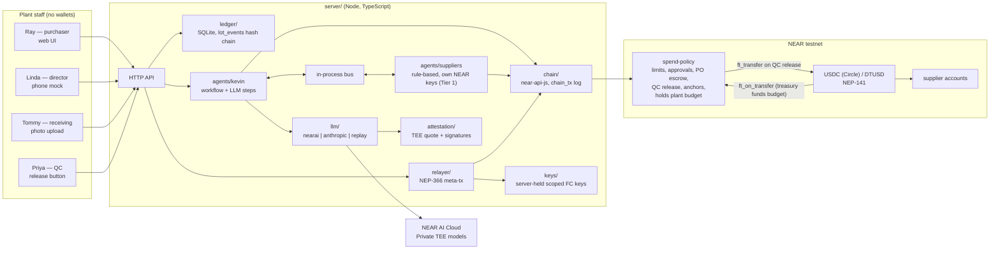

# Architecture — Day One

Decisions here come from `docs/research/`. Each section names the research file that backs it. Versions were verified on 2026-10-22; re-check on Nov 1 before the first install.

---

## 1. Stack

| Layer | Choice | Version | Research |
|---|---|---|---|
| Runtime | Node.js LTS | 24.22.x (`engines: >=22.13`, `.nvmrc`) | 18 |
| Language (off-chain) | TypeScript, one npm workspace monorepo | — | 15 |
| Web | Vite + React + SVG (no graphics library) | React 19.3.x (pin below 19.4 for R3F), Vite 8.3.x | 16 |
| 3D twin (Tier 2) | three + @react-three/fiber + drei, procedural geometry only | 0.186.1 / 9.8.2 / 10.7.9 | 16 |
| Server | Node HTTP API (framework chosen on Nov 1; keep it small) | — | — |
| Ledger | SQLite via better-sqlite3 + Drizzle ORM | 13.0.3 / 0.45.4, drizzle-kit 0.31.11 | 18 |
| NEAR client | near-api-js (single v7 package) | 7.3.1 | 06, 08 |
| NEAR CLI | near-cli-rs | 0.30.1 | 05, 08 |
| Contracts | Rust near-sdk, built with cargo-near, **in WSL2 Ubuntu** | 5.29.1 (Rust ≥1.95) / 0.22.0 | 08 |
| Contract tests | near-sdk unit tests + near-sandbox integration tests (WSL2) | near-sandbox 0.3.16 | 08 |
| LLM (default) | NEAR AI Cloud, OpenAI-compatible, Private TEE models | `openai` npm 7.42.0; model `z-ai/glm-5.3-flash` | 10, 13 |
| LLM (fallback) | Anthropic API | `@anthropic-ai/sdk` 1.1.0; `claude-sonnet-5-5` | 13 |
| Schemas | zod | 4.6.7 | 15 |
| Attestation verify | Phala dcap-qvl | `@phala/dcap-qvl` 0.7.0 | 10 |
| Batch-record rendering | Playwright HTML → JPEG/PDF | chosen Nov 1 | 14 |
| Stablecoin | Circle testnet USDC (NEP-141, 6 decimals) and our labeled DTUSD | see CONTRACTS.md | 01 |

**Why two environments:** off-chain code runs on native Windows Node. Contracts build and test in WSL2 because the NEAR sandbox has no Windows binary and cargo-near ABI generation fails under MSVC (research 08). Source stays on `C:\Dev`; `CARGO_TARGET_DIR` lives on the WSL filesystem.

---

## 2. Components



| Component | Responsibility | Never does |
|---|---|---|
| `web/` | Purchaser UI, phone mock, receiving and QC screens, plant map, behind-the-curtain view, HQ policy view | Hold keys; talk to NEAR directly |
| `server/api` | Routes for uploads, confirmations, approvals, receipts, QC; serves demo state | Enforce spend limits (the contract does) |
| `server/ledger` | Inventory truth: reference data, `lot_events` append-only log with hash chain, projections | Store secrets; mutate past events |
| `agents/kevin` | Extraction, validation, discrepancy detection, forecast, RFQ, ranking, PO drafting, chain calls with Kevin's key | Approve his own POs; move tokens directly |
| `agents/suppliers` (Tier 1) | Respond to RFQs with quotes; each signs with its own account | Bypass escrow |
| `server/llm` | One `LlmClient` interface; routes by task; records fixtures for replay | Choose models ad hoc in call sites |
| `server/chain` | All NEAR calls; writes every attempt to `chain_tx` incl. refusals | Hide failed transactions |
| `server/relayer` | Builds and relays staff delegate actions; allowlists receivers and methods | Relay deposits; relay non-staff senders |
| `server/attestation` | Fetches and verifies NEAR AI Cloud attestation and per-response signatures | — |
| `contracts/spend-policy` | Holds the plant budget; per-agent limits, caps, approvals, pause; funds escrow; record anchors | Pay suppliers |

---

## 3. On-chain vs off-chain boundary

| Data or action | Where | Why |
|---|---|---|
| Spend limits, caps, approver, pause | **On-chain** (spend-policy) | "Enforced, not logged" |
| PO authorization or refusal | **On-chain** | Refusal must be a visible chain result |
| Director approval | **On-chain**, signed by director's key, relayer-paid | Kevin cannot forge it |
| PO funds, escrow, release, refund | **On-chain** (token + spend-policy escrow) | Settlement neither company controls |
| Record fingerprints (batch records, lot event chain, receipts) | **On-chain** hashes in spend-policy + NEP-297 events | Tamper-evident, verifiable by anyone |
| Supplier quote amounts and terms (Tier 1) | On-chain as a hash only | Prices stay private |
| PO amount and supplier | On-chain (unavoidable for settlement) | Stated in README as a limitation |
| Formulas, batch contents, lot quantities, prices per line, staff names | **Off-chain** (SQLite) | Private by default |
| Record salts | Off-chain, shipped with fictional fixtures so judges can verify | Prevents brute-forcing low-entropy hashes |
| LLM inference | NEAR AI Cloud Private TEE (attested) | `privacy` track; fallback disclosed |

Amounts on-chain are integer token base units (6 decimals). The ledger stores the same integers in `*_usdc` columns. The UI is the only place that formats dollars.

---

## 4. Keys and accounts

Full list and creation commands: `CONTRACTS.md` §1 and research 05.

| Account | Key used online | Scope | Who holds it |
|---|---|---|---|
| `kevin.plant-b.acme-holdings.testnet` | Function-call key | `spend-policy`: `submit_po`, `cancel_po`, `anchor`, `anchor_batch` | Server env |
| `director.plant-b…` | Function-call key | `spend-policy`: `approve_po`, `reject_po` | Server env (phone is simulated) |
| `receiving.plant-b…` | Function-call key | `spend-policy`: `confirm_receipt` | Server env |
| `qc.plant-b…` | Function-call key | `spend-policy`: `qc_release`, `qc_reject` | Server env |
| Supplier accounts (Tier 1) | Full-access key | Their own account | Server env (the simulated supplier *is* the agent) |
| `dayone-relayer.testnet` | Full-access key | Pays staff gas | Server env |
| `acme-holdings.testnet` and contract accounts | Full-access keys | Deploy, configure, fund | Human's local credentials only; used by setup scripts |

Function-call keys cannot attach deposits, not even 1 yoctoNEAR (research 03). So no online key can move tokens. Tokens move only when a contract calls `ft_transfer_call` or `ft_transfer` with its own 1 yocto, after its rules pass.

Staff accounts hold 0 NEAR. Relayed delegate actions do not consume the function-call key allowance (research 06).

Revocation has two layers: `pause_agent` in the policy contract (rule level) and `DeleteKey` on Kevin's account (key level).

---

## 5. Main flows

### 5.1 Batch record → inventory
1. Ray uploads BR-B-1045. `server/api` stores the file and its sha256.
2. Kevin calls the vision route of `LlmClient`. The model **transcribes** fields and gives a legibility label per field; it does no arithmetic (research 14).
3. Kevin's code normalizes units, computes yield and waste, validates against the active formula (±0.5%), and flags low-confidence fields.
4. Ray confirms. `ledger.appendLotEvent` writes `issued`/`consumed` events with genealogy (`batch_inputs`), all in one SQLite transaction, extending the hash chain.
5. Kevin checks transfers for discrepancies (`ASC-261009-01`) and raises one.
6. The anchoring job batches new record hashes and calls `spend-policy.anchor_batch` with Kevin's key.

### 5.2 Reorder → refused → approved → escrowed

```mermaid
sequenceDiagram
  participant K as Kevin (FC key)
  participant P as spend-policy
  participant S as server
  participant L as Linda (phone mock)
  participant R as relayer

  K->>P: submit_po(PO-1042, northgate, 5150.00, raw_material, po_hash)
  P-->>K: PANIC "exceeds Kevin's per-PO limit of $2,500.00; director approval required"
  Note over K,P: Explorer shows a red failed tx from kevin.plant-b…
  K->>S: record refused tx hash, request approval
  S->>L: "Kevin needs approval: PO-1042 … Reply YES 1042"
  L->>S: YES 1042
  S->>R: delegate action approve_po(… refused_tx) signed with director's FC key
  R->>P: relayed tx (signer = relayer, predecessor = director)
  P-->>R: po_approved event
  K->>P: submit_po(same args) — retry
  P-->>K: po_authorized + po_funded (budget → escrow inside the same contract)
```

### 5.3 Receipt → QC → payment
0. Northgate’s agent reads `get_po`, sees the funds held, and signs `accept_po` and `mark_shipped(PO-1042, supplier_lot)` from its own account.
1. Tommy photographs the packing slip. Kevin matches it to PO-1042 (vendor, material, quantity, supplier lot).
2. Server relays `spend-policy.confirm_receipt(PO-1042)` signed with Tommy's key. Lot event `received → quarantine`.
3. Priya taps Release. Server relays `spend-policy.qc_release(PO-1042)` signed with Priya's key. Escrow pays the supplier with `ft_transfer`; a callback rolls back on failure. Lot event `quarantine → released`.
4. Marcy's screen shows "PO-1042 — paid $5,150.00", invoice matched to PO and receipt.

### 5.4 Supplier agents (Tier 1)
Kevin publishes an RFQ on the in-process bus. Each `SupplierAgent` replies with a quote and anchors its quote hash from its own account. Kevin ranks quotes, excludes unqualified vendors, and drafts the PO. The supplier's account is the escrow payee.

---

## 6. Modes

| Mode | Needs | Chain | LLM | Purpose |
|---|---|---|---|---|
| `replay` (default for judges) | Nothing: no keys, no network for the core run | Reads recorded tx results from `data/replay/` | Recorded responses | Clean clone → full demo with real tx hashes and explorer links |
| `live` | `.env` from `.env.example`, testnet accounts | Real testnet | NEAR AI Cloud (or Anthropic) | Development and recording the video |
| `verify` | Network only (public RPC) | Read-only `view` calls | — | Judges recompute record hashes and check on-chain anchors |

Determinism: seeded event list with fixed timestamps and a demo clock. Sampling parameters are not supported on current Claude models (research 13), so determinism comes from replay fixtures, not temperature.

---

## 7. Repository layout (target by Nov 13)

```
contracts/              Cargo workspace (built in WSL2)
  spend-policy/         limits, approvals, pause, anchors
agents/
  kevin/                workflow, tools, prompts
  suppliers/            created when Tier 1 starts
server/
  api/  ledger/  llm/  chain/  relayer/  keys/  attestation/  sms/
web/
  src/  (purchaser, phone, receiving, qc, hq, map, curtain; twin3d/ only if Tier 2 ships)
data/
  seed/  batch-records/  replay/
scripts/                setup-testnet, deploy, seed, demo, demo-replay, verify, reset
tests/                  integration and end-to-end
```

Every command is listed in `AGENTS.md` on the day it first works.
